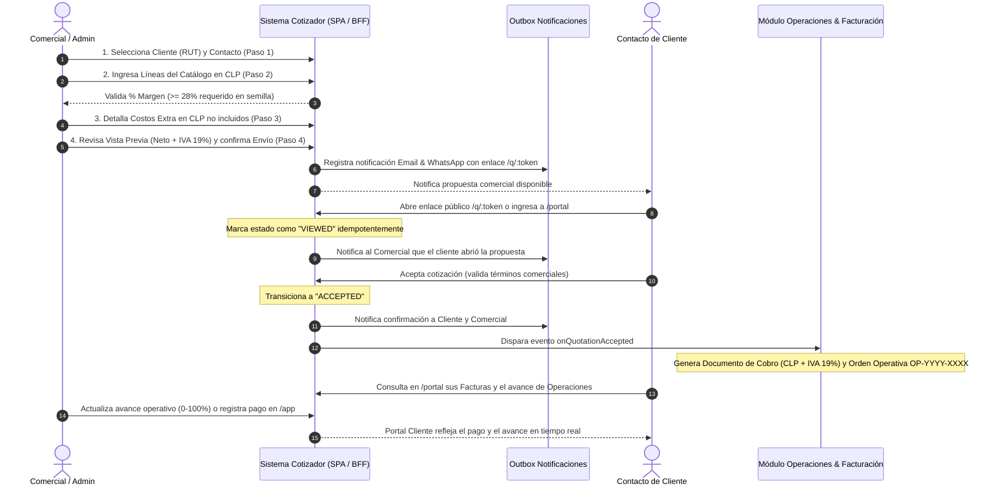
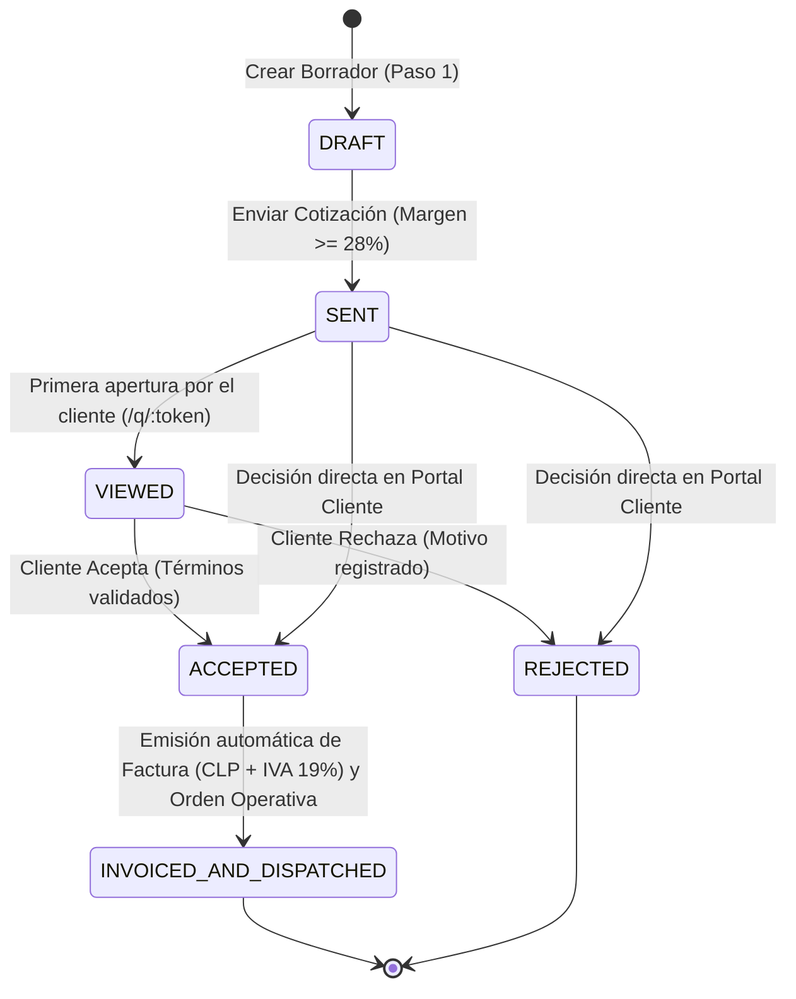
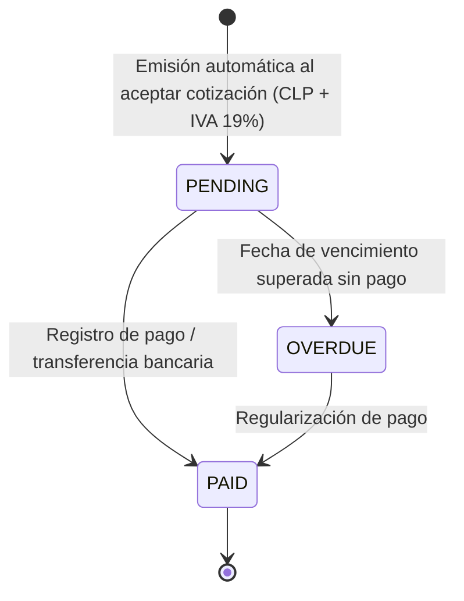
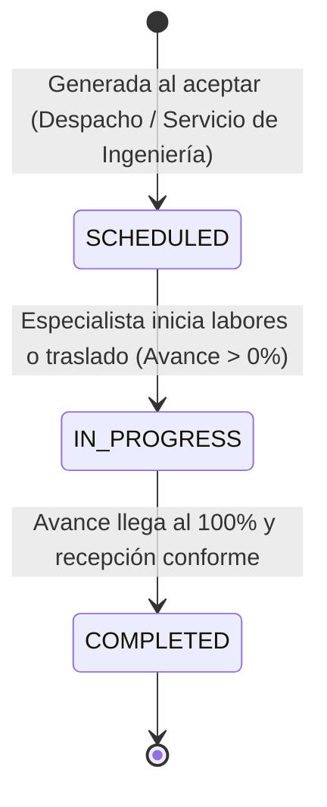
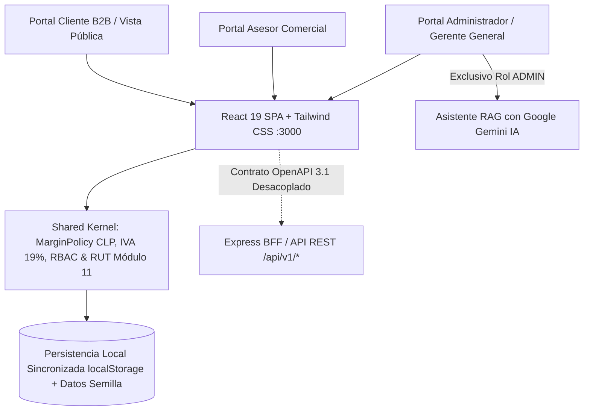
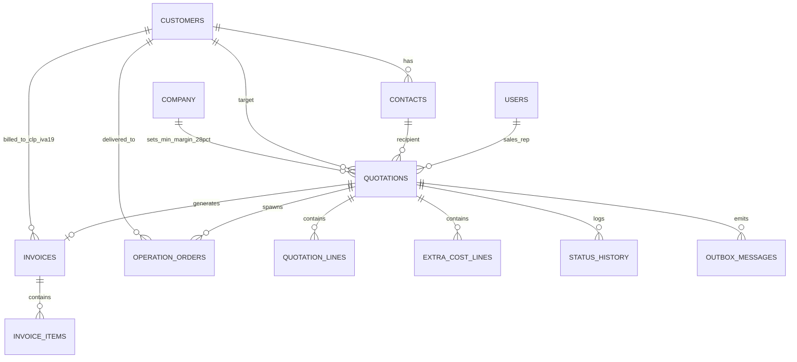

# Cotizador Online &mdash; Sistema Integral de Gestión de Cotizaciones y Portal de Clientes

Sistema web completo de nivel corporativo para la gestión centralizada de cotizaciones (proformas) de **productos y servicios**, diseñado para reemplazar hojas de cálculo de Excel sin control. Integra **tres portales sincronizados** (**Portal Administrador**, **Portal Asesor Comercial** y **Portal Cliente**) bajo un **login unificado**, con control estricto del **margen bruto comercial (mínimo 28% configurado en datos semilla)**, moneda nacional en **Pesos Chilenos (CLP)** e **IVA 19%**, trazabilidad de estados, **Asistente RAG con Gemini IA exclusivo para Gerencia/Administración** y los módulos transversales post-aceptación de **Facturas (Documentos de Cobro)** y **Operaciones**.

---

## Tabla de Contenidos
1. [Descripción General](#1-descripción-general)
2. [Objetivos de Negocio](#2-objetivos-de-negocio)
3. [Glosario y Lenguaje Ubicuo (Ubiquitous Language)](#3-glosario-y-lenguaje-ubicuo)
4. [Funcionalidades en Detalle, Pantalla por Pantalla](#4-funcionalidades-en-detalle-pantalla-por-pantalla)
   - 4.1 Login Unificado (`/login`) y Estructura de los 3 Portales Sincronizados
   - 4.2 Dashboard del Panel General (`/app/dashboard`) y Visibilidad RBAC de KPIs
   - 4.3 Asistente de Cotización (Wizard de 4 Pasos)
   - 4.4 Vista Pública de Cotización (`/q/:token`)
   - 4.5 Portal del Cliente (`/portal`) con Facturas y Operaciones Habilitadas
   - 4.6 Módulos Transversales de Facturación y Operaciones (Panel Interno `/app`)
   - 4.7 Asistente RAG con Gemini IA (Exclusivo Portal Administrador)
   - 4.8 Asignación del Equipo Comercial (Solo Administrador)
   - 4.9 Gestión Compartida de Clientes y Contactos (Admin & Panel Comercial)
   - 4.10 Logs de Auditoría y Exportación a CSV (`.csv`)
   - 4.11 Copia de Seguridad y Respaldo del Sistema (Backup & Restore)
   - 4.12 Gobierno Corporativo: Margen Mínimo Estático en Panel Comercial
   - 4.13 Diseño Ergonómico y Paleta de Colores Unificada
5. [Flujo de Proceso (Diagrama BPMN y Secuencia End-to-End)](#5-flujo-de-proceso)
6. [Máquinas de Estado del Sistema](#6-máquinas-de-estado-del-sistema)
   - 6.1 Ciclo de Vida de la Cotización
   - 6.2 Ciclo de Vida de la Factura (Documento de Cobro)
   - 6.3 Ciclo de Vida de la Orden Operativa (Despacho / Servicio)
7. [Regla de Margen (MarginPolicy)](#7-regla-de-margen)
8. [Productos y Servicios](#8-productos-y-servicios)
9. [Arquitectura y Estado de Ejecución (SPA + Persistencia Local Desacoplada)](#9-arquitectura)
10. [Modelo de Dominio y Agregados](#10-modelo-de-dominio-y-agregados)
11. [Base de Datos (Diagrama Entidad-Relación Integral)](#11-base-de-datos)
12. [Contrato de la API (OpenAPI 3.1 & BFF)](#12-contrato-de-la-api-openapi)
13. [Seguridad y Control de Acceso (RBAC)](#13-seguridad)
14. [Notificaciones (Outbox Pattern, Email & WhatsApp)](#14-notificaciones)
15. [Modo de Tema UX/UI (Claro / Oscuro / Sistema)](#15-internacionalización-y-modo-de-tema)
16. [Puesta en Marcha Paso a Paso](#16-puesta-en-marcha-paso-a-paso)
17. [Variables de Entorno](#17-variables-de-entorno)
18. [Scripts Disponibles](#18-scripts)
19. [Estrategia de Testing y TDD](#19-estrategia-de-testing-y-tdd)
20. [Estructura de Carpetas](#20-estructura-de-carpetas)
21. [Inventario de Datos Semilla y Mock Data (DATOS_SEMILLA.md)](#21-inventario-de-datos-semilla-y-mock-data)
22. [Guías para Extender el Sistema](#22-guías-para-extender-el-sistema)
23. [Convenciones de Código y Buenas Prácticas](#23-convenciones-de-código)
24. [Solución de Problemas (Troubleshooting) & FAQ](#24-solución-de-problemas-y-faq)
25. [Roadmap Futuro](#25-roadmap)

---

## 1. Descripción General

Tradicionalmente, las áreas comerciales emiten cotizaciones utilizando plantillas de Excel desconectadas. Esto genera errores críticos en la operación corporativa:
- Ventas con márgenes inferiores al costo operativo real por falta de cálculo riguroso.
- Falta de visibilidad sobre cuándo un cliente revisó una propuesta.
- Discrepancias entre las listas de precios oficiales en **CLP** y lo ofrecido por cada vendedor.
- Clientes que pierden el historial de ofertas o no cuentan con un mecanismo formal para aceptar o rechazar.
- **Ruptura de continuidad operativa post-venta:** una vez aceptada la oferta, la emisión de documentos de cobro y el seguimiento de despachos o ejecuciones de ingeniería se gestionan en silos desarticulados.

**Cotizador Online** resuelve este problema mediante una plataforma web unificada en TypeScript estructurada en **3 portales sincronizados**:
1. **Portal Administrador (Gerente General):** Control total de la operación, configuración institucional y del margen mínimo corporativo (28%), visión ejecutiva global consolidada, analíticas comparativas de todos los asesores comerciales y acceso exclusivo al **Asistente RAG con Gemini IA** para consulta de documentación técnica, normativa y soporte a cotizaciones.
2. **Portal Asesor Comercial:** Gestión de cartera de clientes, creación de cotizaciones mediante asistente guiado (Wizard de 4 pasos con validación matemática de margen >= 28% en CLP + IVA 19%), seguimiento de sus propias órdenes operativas y **visualización estricta de sus propias métricas/KPIs personales** en el Panel General (sin acceso a métricas globales ni de otros asesores).
3. **Portal Cliente:** Autoservicio B2B, consulta interactiva de cotizaciones recibidas (listado, calendario y línea de tiempo), aceptación o rechazo formal en línea, trazabilidad en tiempo real de órdenes operativas y visualización/descarga de documentos de cobro (`DC-XXXXXX` / `FE-XXXXXX`).
4. **Continuidad Post-Aceptación (Coherencia Transversal):**
   - Cuando una cotización es aceptada, el sistema dispara automáticamente el evento de dominio `QuotationAccepted`, originando de forma inmediata el **Documento de Cobro** correlativo en CLP (con IVA 19%) y las **Órdenes de Operación** correspondientes (despacho físico de suministros y/o ejecución técnica de servicios de ingeniería naval).
   - Los tres portales comparten la misma fuente de verdad sincronizada en tiempo real.
5. **Estado de Ejecución y Persistencia Actual:** La aplicación opera actualmente como una **SPA (Single Page Application) en el frontend** con datos semilla estructurados (`DATOS_SEMILLA.md`) y sincronización/persistencia local resiliente en el navegador (`localStorage` con validación y recuperación automática ante corrupción), manteniendo una arquitectura hexagonal desacoplada y contratos REST/OpenAPI listos para la integración con el backend.

---

## 2. Objetivos de Negocio

| N.º | Objetivo de Negocio | Cómo lo resuelve la plataforma |
|---|---|---|
| **1** | **Control por comercial y aislamiento RBAC** | El Administrador audita el consolidado global y la comparativa de todos los asesores; cada Asesor Comercial visualiza únicamente su propio resumen y KPIs personales tanto en UI como a nivel de autorización/filtrado. |
| **2** | **Control del estado** | El cliente tiene el control decisivo: la primera apertura marca automáticamente como `Vista` (notificando al vendedor), y el cliente formaliza la decisión con `Aceptar` o `Rechazar`. |
| **3** | **Interacción del cliente** | Portal de autoservicio B2B sin barreras y enlaces públicos responsivos (`/q/:token`) que permiten decidir e imprimir en PDF. |
| **4** | **Control de margen en CLP** | La regla de negocio `MarginPolicy` impide el avance del borrador o el envío de cualquier propuesta que no alcance el margen mínimo configurado en los datos semilla (**28.0%**). |
| **5** | **Control de la cartera** | Los clientes pertenecen a la empresa y no al comercial individual. Solo el rol `Admin` puede aplicar bajas lógicas (`deleted_at`). |
| **6** | **Trazabilidad Post-Venta (Facturas y Operaciones)** | Habilitación plena y sincronizada de los módulos de Facturación (CLP + IVA 19%) y Operaciones en los tres portales, garantizando visibilidad compartida de documentos de cobro, pagos, guías y avances. |

---

## 3. Glosario y Lenguaje Ubicuo

| Término en Español | Código (Inglés) | Definición en el Dominio |
|---|---|---|
| Cotización | `Quotation` | Documento comercial formal valorizado en CLP netos más IVA 19% que contiene líneas cotizadas, costos extra, estados y totales calculados. |
| Administrador / Gerente | `Admin` | Rol ejecutivo con acceso global a KPIs consolidados, configuración de margen mínimo, bajas lógicas, respaldos y Asistente RAG con Gemini IA. |
| Comercial / Asesor | `SalesRep` | Usuario interno asignado a la elaboración de cotizaciones, seguimiento de sus órdenes y visualización exclusiva de sus propios KPIs. |
| Cliente | `Customer` | Persona jurídica o empresa chilena (identificada por RUT módulo 11) a la que se le presentan propuestas comerciales. |
| Contacto | `Contact` | Persona natural dentro de la empresa cliente con acceso al Portal Cliente (`/portal`). |
| Ítem de catálogo | `CatalogItem` | Elemento base de la lista de precios en CLP, discriminado en `Product` o `Service`. |
| Producto | `Product` | Bien o suministro físico identificable por SKU, marca y unidad de medida entera o decimal. |
| Servicio | `Service` | Prestación intangible de ingeniería o peritaje medida en unidades de tiempo (hora, día, mes) o alcance (global). |
| Costo extra | `ExtraCost` | Costo adicional informativo en CLP (flete, viáticos) que se muestra al cliente sin sumar al subtotal neto ni distorsionar el margen. |
| Margen | `Margin` | Porcentaje de ganancia bruta sobre el precio de venta neto en CLP: `(precio - costo) / precio * 100`. |
| Enviada | `Sent` | Estado formal tras el despacho de la cotización; genera el enlace público `/q/:token` y notificaciones. |
| Vista | `Viewed` | Estado transicional que se activa de forma idempotente la primera vez que el cliente abre la cotización. |
| Aceptada | `Accepted` | Estado final exitoso donde el cliente aprueba la propuesta y acepta los términos comerciales. |
| Rechazada | `Rejected` | Estado final desestimado con registro del motivo de rechazo. |
| Documento de Cobro / Factura | `Invoice` | Comprobante fiscal y comercial en CLP (subtotal neto + IVA 19% = total bruto) emitido tras la aceptación, con fecha de vencimiento y estado de cobro. |
| Orden Operativa | `OperationOrder` | Orden de ejecución generada automáticamente tras la aceptación, categorizada como Despacho de Productos o Ejecución de Servicios. |
| Guía de Despacho | `GuideNumber` | Identificador de traslado físico de mercancías (`GD-YYYY-XXXXXX`) emitido para órdenes de despacho de productos. |
| Avance Operativo | `ProgressPct` | Porcentaje de cumplimiento (0 a 100%) gestionado por el equipo interno y visible en tiempo real en el Portal Cliente. |
| Asistente RAG | `RagAssistant` | Módulo de Retrieval-Augmented Generation con Google Gemini exclusivo del Portal Administrador para consulta de bases técnicas y normativas. |

---

## 4. Funcionalidades en Detalle, Pantalla por Pantalla

### 4.1 Login Unificado (`/login`) y Estructura de los 3 Portales Sincronizados
- **Acceso único** para Administradores, Asesores Comerciales y Contactos de Clientes, con selector de demostración rápida en entorno local.
- **Arquitectura de 3 Portales Sincronizados:**
  1. **Portal Administrador (Gerente General - `/app`):**
     - Control total de la plataforma, configuración institucional de la empresa y del margen mínimo obligatorio (28%).
     - Visión ejecutiva global en el Panel General con analíticas comparativas de todos los asesores comerciales.
     - **Acceso exclusivo al Asistente RAG con Gemini IA** para consulta de especificaciones técnicas, normativa marítima/industrial y apoyo en cotizaciones complejas.
     - Administración de usuarios comerciales, bajas lógicas de clientes/contactos, exportación de auditoría CSV y Backup/Restore.
  2. **Portal Asesor Comercial (`/app`):**
     - Gestión de cartera de clientes y contactos, creación y versionado de cotizaciones mediante el Wizard de 4 pasos (con paginación de 15 cotizaciones por página en el listado).
     - Seguimiento de sus propias cotizaciones, documentos de cobro y órdenes operativas asignadas.
     - **Aislamiento estricto en el Panel General:** visualiza únicamente su propio resumen ejecutivo y sus métricas/KPIs personales, sin acceso a métricas del administrador ni de otros asesores.
  3. **Portal Cliente (`/portal`):**
     - Portal de autoservicio B2B para la empresa cliente autenticada.
     - Consulta de cotizaciones (listado, calendario mensual y línea de tiempo), aceptación o rechazo formal en línea, trazabilidad de órdenes operativas (0% a 100%) y visualización/impresión de documentos de cobro en CLP con IVA 19%.

### 4.2 Dashboard del Panel General (`/app/dashboard`) y Visibilidad RBAC de KPIs
El Panel General aplica reglas estrictas de visibilidad y permisos según el rol autenticado:
- **Rol Administrador (`ADMIN` - Alcance `GLOBAL`):**
  - Visualiza el resumen general consolidado de toda la compañía en CLP (Total Cotizado, Total Adjudicado, Pipeline Activo, Tasa de Conversión Global y Margen Bruto Promedio).
  - Visualiza la tabla y gráficos comparativos de rendimiento de **todos los asesores comerciales** (volumen de ofertas, adjudicaciones en CLP, tasa de cierre y margen promedio por asesor), además del balance global de Productos vs. Servicios.
- **Rol Asesor Comercial (`SALES_REP` - Alcance `PERSONAL`):**
  - Solo visualiza **su propio resumen y sus métricas/KPIs personales** (sus cotizaciones emitidas, aceptadas, vistas, su monto adjudicado en CLP, su tasa de cierre personal y su margen promedio).
  - Tiene restringido el acceso a las métricas consolidadas del administrador y al desglose de otros asesores (tanto en la interfaz de usuario como mediante el filtrado/autorización en la capa de servicios y API `GET /api/v1/dashboard/summary`, que rechaza con `403 Forbidden` cualquier intento de consultar otro `salesRepId`).

### 4.3 Asistente de Cotización (Wizard de 4 Pasos)
1. **Paso 1 (Cliente & Contacto):** Selección de la empresa y contacto destinatario. Los datos tributarios chilenos (RUT, giro, dirección) se presentan en modo solo lectura.
2. **Paso 2 (Detalle & Margen en CLP):**
   - Buscador en catálogo filtrable por Producto o Servicio con valores en Pesos Chilenos (`$ CLP` sin decimales).
   - Columnas reactivas con cálculo bidireccional entre Margen % y Precio Unitario Neto en CLP.
   - Si el margen consolidado es menor al mínimo corporativo (**28%** en datos semilla), el botón "Siguiente" queda bloqueado y se muestra una alerta con el **faltante exacto en CLP** necesario para alcanzar el margen exigido.
3. **Paso 3 (Costos Extra):** Permite registrar conceptos complementarios informativos en CLP (ej. viáticos en terreno, traslado naval) sin que sumen al subtotal cotizado ni distorsionen el margen.
4. **Paso 4 (Vista Previa & Envío):**
   - Vista preliminar formal con líneas agrupadas en "Productos" y "Servicios", subtotal neto en CLP, **IVA 19%** y total bruto en CLP.
   - Edición de carta de presentación, notas, condiciones de pago y validez en días.
   - Guardado como borrador y **Envío formal** con generación de token público.

### 4.4 Vista Pública de Cotización (`/q/:token`)
- Acceso directo sin contraseña mediante token criptográfico seguro.
- La primera apertura ejecuta el evento de dominio `QuotationViewed`, notificando de inmediato al asesor comercial.
- Vista 100% sanitizada: muestra precios unitarios netos en CLP, subtotal neto, IVA (19%) y total bruto, ocultando costos internos y márgenes de ganancia.
- Checkbox obligatorio de aceptación de términos y botones de Aceptar o Rechazar.
- Al aceptar, se dispara automáticamente la emisión del Documento de Cobro y de las Órdenes Operativas.

### 4.5 Portal del Cliente (`/portal`) con Facturas y Operaciones Habilitadas
El portal corporativo para clientes (`/portal`) ofrece autoservicio completo y sincronizado:
1. **Panel General (`/portal/dashboard`):**
   - Tarjetas de resumen con cotizaciones activas, aceptadas, total facturado en CLP y órdenes operativas en ejecución.
2. **Mis Cotizaciones (`/portal/quotations`):**
   - Listado completo de propuestas recibidas por la empresa cliente con filtros por estado, buscador y aceptación/rechazo en línea.
3. **Calendario Mensual (`/portal/calendar`):**
   - Vista de calendario interactiva con selector de mes y año para identificar emisiones y vencimientos de ofertas.
4. **Línea de Tiempo (`/portal/timeline`):**
   - Registro cronológico de todas las interacciones comerciales del cliente.
5. **Documentos de Cobro / Facturas (`/portal/invoices`):**
   - Consulta centralizada de facturas electrónicas / documentos de cobro emitidos a nombre de la empresa cliente.
   - Indicadores de estado: `PAGADA` (esmeralda), `PENDIENTE` (ámbar) y `VENCIDA` (rojo).
   - Tarjetas y modal de detalle con **Subtotal Neto en CLP, IVA (19%) y Total Bruto en CLP**, condiciones de pago y botón de **Impresión / Exportación a PDF**.
6. **Operaciones (`/portal/operations`):**
   - Seguimiento logístico y técnico en tiempo real para todos los pedidos derivados de cotizaciones aceptadas.
   - **Despacho de Productos:** número de orden, guía de despacho chilena asociada (`GD-2026-XXXXXX`), transportista, dirección de entrega y barra de progreso.
   - **Ejecución de Servicios:** alcance técnico, ingeniero naval asignado, fecha programada y porcentaje de avance (0% a 100%).

### 4.6 Módulos Transversales de Facturación y Operaciones (Panel Interno `/app`)
1. **Facturación & Cobranzas (`/app/invoices`):**
   - Tarjetas métricas en CLP: Total Facturado, Total Cobrado y Saldo Pendiente de Cobro.
   - Listado de documentos de cobro con filtro por estado (`TODAS`, `PENDIENTES`, `PAGADAS`, `VENCIDAS`) y acción directa para registrar pagos (`Marcar como Pagada`).
2. **Operaciones & Despacho (`/app/operations`):**
   - Tablero de control de entregas de suministros y ejecuciones de servicios de ingeniería.
   - **Slider de Avance en Tiempo Real (0% a 100%)** y transición entre `PROGRAMADA`, `EN PROCESO` y `COMPLETADA`, reflejándose instantáneamente en el Portal Cliente.

### 4.7 Asistente RAG con Gemini IA (Exclusivo Portal Administrador)
- **Ubicación y Acceso Exclusivo:** El componente **RAG (Retrieval-Augmented Generation)** potenciado por **Google Gemini IA** reside exclusivamente en el **Portal Administrador**. Los asesores comerciales y clientes no tienen acceso a este módulo.
- **Recuperación y Consulta de Documentación Técnica:** Permite a la Gerencia General cargar, indexar y consultar especificaciones técnicas, normativas marítimas (DIRECTEMAR, SOLAS, clasificación de aceros y recubrimientos), históricos de cotizaciones y manuales operativos para respaldar decisiones técnicas y comerciales con contexto verificado.
- **Análisis Multimodal y Chat Ejecutivo:** Soporta consultas multiturno sobre rentabilidad de cartera, redacción de alcances técnicos complejos y análisis de requerimientos.

### 4.8 Asignación del Equipo Comercial (Solo Administrador)
- **Control Centralizado de Asesores:** La Gerencia / Administrador define qué profesionales integran el equipo comercial.
- **Control de Acceso Inmediato:** Interruptor para habilitar o suspender el ingreso al Portal Comercial de cualquier asesor.

### 4.9 Gestión Compartida de Clientes y Contactos (Admin & Panel Comercial)
- **Cartera Corporativa:** Tanto el Administrador como los Asesores Comerciales pueden dar de alta clientes (validando RUT chileno único con dígito verificador módulo 11) y editar contactos. **Solo el Administrador** puede ejecutar bajas lógicas (`deleted_at`) de clientes y contactos.

### 4.10 Logs de Auditoría y Exportación a CSV (`.csv`)
- Bitácora inmutable de acciones sobre catálogo, clientes, parámetros de empresa, cotizaciones y accesos.
- **Exportación a CSV (Solo Admin):** Descarga con codificación UTF-8 con BOM (`\uFEFF`) y sanitización contra inyección de fórmulas (OWASP).

### 4.11 Copia de Seguridad y Respaldo del Sistema (Backup & Restore)
- Exportación íntegra del estado del sistema en JSON y restauración transaccional validada, restringida exclusivamente al rol `ADMIN`.

### 4.12 Gobierno Corporativo: Margen Mínimo Estático en Panel Comercial
- Solo el Portal Administrador puede modificar el Margen Mínimo Corporativo (**28.0%** por defecto en datos semilla). En el Portal Asesor Comercial el parámetro se exhibe en modo estrictamente de solo lectura (`🔒 Estático • Solo Lectura`).

### 4.13 Diseño Ergonómico y Paleta de Colores Unificada
- **Paleta Corporativa Uniforme:** Los 3 portales (Administrador, Asesor Comercial y Cliente) comparten una paleta visual unificada basada en el diseño ejecutivo del Portal Administrador.
- **Paginación Estandarizada:** El panel de Cotizaciones pagina automáticamente cada **15 cotizaciones** para garantizar fluidez visual y rendimiento.
- **Menús Laterales Simétricos:** Botones de navegación, controles de tema y cierre de sesión alineados en la misma posición ergonómica en todos los portales.

---

## 5. Flujo de Proceso

El flujo de información y estados modela la interacción completa desde la creación del borrador hasta la facturación en CLP y la ejecución operativa:



---

## 6. Máquinas de Estado del Sistema

### 6.1 Ciclo de Vida de la Cotización



### 6.2 Ciclo de Vida de la Factura (Documento de Cobro)



### 6.3 Ciclo de Vida de la Orden Operativa



---

## 7. Regla de Margen (`MarginPolicy`)

El sistema opera bajo el **margen bruto comercial sobre el precio de venta neto en Pesos Chilenos (CLP)** como único criterio financiero corporativo. Todos los montos en CLP se manejan como **números enteros sin decimales**, aplicando el **IVA legal chileno del 19%** sobre el subtotal neto:

$$\text{Margen \%} = \frac{\text{Precio Venta Neto CLP} - \text{Costo Total CLP}}{\text{Precio Venta Neto CLP}} \times 100$$

### Recálculo de Precio Unitario Neto en CLP a partir del Margen Objetivo:
$$\text{Precio Neto CLP} = \left\lceil \frac{\text{Costo CLP}}{1 - (\text{Margen} / 100)} \right\rceil$$
*Nota:* El precio resultante en CLP siempre se redondea hacia arriba al peso entero superior (`ROUND_UP` / `Math.ceil`) para garantizar matemáticamente que el margen real nunca quede por debajo del umbral corporativo exigido (**28.0%** en los datos semilla).

### Cálculo de Impuesto (IVA 19%) y Total Bruto en CLP:
$$\text{IVA CLP} = \text{round}(\text{Subtotal Neto CLP} \times 0.19)$$
$$\text{Total Bruto CLP} = \text{Subtotal Neto CLP} + \text{IVA CLP}$$

### Faltante en CLP en caso de Margen Insuficiente:
$$\text{Faltante CLP} = \left\lceil \frac{\text{Costo Total CLP}}{1 - (\text{Margen Mínimo} / 100)} \right\rceil - \text{Venta Neta Actual CLP}$$

### Ejemplos Numéricos de Verificación en CLP (Margen Mínimo Semilla = 28%):

#### Caso 1: Margen Insuficiente con Faltante en CLP
- Costo Total: **$ 720.000 CLP**
- Precio de Venta Neto Actual: **$ 910.000 CLP** (Margen actual: $20.88\%$)
- Margen Mínimo Corporativo (Semilla): **28.00%**
- Venta Neta Requerida: $720.000 / (1 - 0.28) = 720.000 / 0.72 = \mathbf{\$\ 1.000.000\text{ CLP}}$
- **Faltante exacto en CLP:** $1.000.000 - 910.000 = \mathbf{\$\ 90.000\text{ CLP}}$
- *Resultado:* El asistente bloquea el avance del Paso 2 y muestra la alerta indicando que faltan **$ 90.000 CLP** en el subtotal neto para cumplir el 28% exigido.

#### Caso 2: Margen del 28% con Redondeo al Peso Chileno Entero Superior
- Línea 1: Costo **$ 250.000 CLP**, Margen objetivo **28%** $\to 250.000 / 0.72 = 347.222,22... \to$ Precio Unitario Neto **$ 347.223 CLP** (Margen real: $28.0001\%$).
- IVA (19%): $\text{round}(347.223 \times 0.19) = \mathbf{\$\ 65.972\text{ CLP}}$.
- Total Bruto con IVA: **$ 413.195 CLP**.
- *Resultado:* Pasa exitosamente gracias al redondeo hacia arriba al peso entero en CLP.

#### Caso 3: Compensación de Líneas sobre el Consolidado Neto en CLP
- Línea 1 (Servicio de Ingeniería): Costo **$ 600.000 CLP**, Venta Neta **$ 750.000 CLP** (Margen línea: $20.0\%$)
- Línea 2 (Suministro Naval): Costo **$ 480.000 CLP**, Venta Neta **$ 750.000 CLP** (Margen línea: $36.0\%$)
- Total Venta Neta: **$ 1.500.000 CLP** | Total Costo: **$ 1.080.000 CLP** | Utilidad Bruta: **$ 420.000 CLP**.
- Margen consolidado: $(420.000 / 1.500.000) \times 100 = \mathbf{28.00\%}$.
- IVA (19%): **$ 285.000 CLP** $\to$ Total Bruto Facturable: **$ 1.785.000 CLP**.
- *Resultado:* Pasa exitosamente porque la regla `MarginPolicy` evalúa el margen consolidado de la propuesta.

---

## 8. Productos y Servicios

| Atributo | Producto (`PRODUCT`) | Servicio (`SERVICE`) |
|---|---|---|
| **Identificador** | **SKU** único obligatorio (ej. `SUM-ANO-ZN-12`) | Código técnico (ej. `ING-EST-01`) |
| **Unidad de Medida** | UND, CAJA, KG, M, M2, L, KIT | HORA, DIA, MES, VISITA, GLOBAL, PROYECTO |
| **Validación de Cantidad** | Entera para UND o CAJA; decimal para otras | Decimal siempre permitido (ej. 1.5 días) |
| **Valorización** | Precio y costo unitario en **CLP enteros** + IVA 19% | Precio y costo unitario en **CLP enteros** + IVA 19% |
| **Presentación** | Agrupados en sección "Productos" en vista y PDF | Agrupados en sección "Servicios" en vista y PDF |
| **Operación derivada** | Genera orden `PRODUCT_DELIVERY` con Guía `GD-YYYY-XXXXXX` | Genera orden `SERVICE_EXECUTION` con ingeniero responsable |
| **Snapshot** | Congela nombre, SKU, costo CLP y precio CLP al cotizar | Congela alcance, costo CLP y tarifa CLP al cotizar |

---

## 9. Arquitectura

### Estado Actual de Ejecución: SPA Frontend con Persistencia Local Desacoplada
Actualmente, la plataforma se ejecuta de forma autónoma como una **Single Page Application (SPA) en React 19 + TypeScript**, inicializada con un inventario rico de **datos semilla estructurados (`DATOS_SEMILLA.md`)** y respaldada por un motor de **sincronización y persistencia local (`localStorage`)** con validación defensiva de esquemas y recuperación ante corrupción de datos.

Esta arquitectura desacoplada permite que los **3 portales (Administrador, Asesor Comercial y Cliente)** interactúen de inmediato sobre un estado compartido en el navegador, mientras que la capa de dominio (`shared-kernel`), los contratos **OpenAPI 3.1 (`contracts/openapi.yaml`)** y las rutas del servidor Express BFF (`src/server/`) están completamente definidos y listos para conectar o alternar con persistencia en base de datos de servidor sin modificar los componentes de interfaz.

### Diagrama de Contexto y Contenedores (C4)


### Arquitectura de Módulos del Sistema
```
src/
  ├── server/             # Especificación de rutas BFF Express, middlewares RBAC y esquemas Zod
  │     ├── routes/       # Endpoints REST (auth, quotations, customers, catalog, dashboard, etc.)
  │     ├── middleware/   # Autenticación Bearer, rate limiting, control de acceso RBAC
  │     └── schemas.ts    # Validación estricta con esquemas Zod
  ├── shared-kernel/      # Núcleo de dominio compartido (CLP, IVA 19%, Margen 28%, RBAC, RUT)
  │     ├── pricing/      # MarginPolicy y cálculo determinista en CLP enteros + IVA 19%
  │     ├── permissions.ts# Matriz de permisos canónica por rol (ADMIN, SALES_REP, CUSTOMER_CONTACT)
  │     ├── formatMoney.ts# Formateo único de moneda chilena ($ CLP sin decimales)
  │     ├── rut.ts        # Validación de RUT chileno con dígito verificador módulo 11
  │     └── value-objects.ts # Validaciones de dominio (Money, Percentage, Quantity)
  ├── ui/                 # Frontend SPA React 19 + Tailwind CSS 4
  │     ├── components/   # Portales (Admin, Comercial, ClientPortal, PublicQuotationView, Wizard, RAG)
  │     └── api.ts        # Adaptador de servicios y sincronización con almacenamiento local / API
  └── modules/            # Tipos de dominio, store reactivo y datos semilla (M&L Ingeniería Naval SpA)
```

---

## 10. Modelo de Dominio y Agregados

### Agregado `Quotation`
- **Identificador:** UUID / `COT-XXXXXX`
- **Entidades hijas:** `QuotationLine[]`, `ExtraCostLine[]`, `StatusHistoryEntry[]`
- **Value Objects:** `Money` (CLP entero), `Percentage`, `Quantity`, `PublicToken`
- **Invariantes protegidas:**
  1. `Quotation.marginPct >= minMarginPct` (28% en semilla) para poder enviarse al cliente.
  2. Cotizaciones solo son editables en estado `DRAFT`.
  3. Toda aceptación exige haber marcado `termsAccepted == true`.
  4. Los costos extra son informativos y no alteran el subtotal neto ni el margen comercial.
  5. El IVA se calcula al **19%** sobre el subtotal neto en CLP.

### Agregado `Invoice` (Documento de Cobro / Factura Electrónica)
- **Identificador:** UUID / `DC-XXXXXX` / `FE-XXXXXX`
- **Atributos:** `quotationId`, `customerId`, `subtotalNetClp`, `taxRatePct` (`19`), `taxAmountClp`, `totalGrossClp`, `status` (`PENDING`, `PAID`, `OVERDUE`), `paymentMethod`, `paymentTerms`.
- **Entidades hijas:** `InvoiceItem[]`

### Agregado `OperationOrder`
- **Identificador:** UUID / `OP-2026-XXXX`
- **Atributos:** `quotationId`, `customerId`, `type` (`PRODUCT_DELIVERY`, `SERVICE_EXECUTION`), `status` (`SCHEDULED`, `IN_PROGRESS`, `COMPLETED`), `progressPct` (0 a 100), `assignedStaff`, `guideNumber` (`GD-2026-XXXXXX`), `deliveryAddress`.

---

## 11. Base de Datos



---

## 12. Contrato de la API (OpenAPI)

El contrato formal **OpenAPI 3.1** se ubica en `contracts/openapi.yaml` (documentando todos los esquemas en CLP enteros, IVA 19%, RBAC por rol y respuestas de error RFC 7807) y puede consultarse interactivamente mediante Swagger UI en:
**`http://localhost:3000/api-docs`**

### Endpoints Principales del Contrato:

| Método | Endpoint | Rol Requerido | Descripción |
|---|---|---|---|
| `POST` | `/api/v1/auth/login` | Público | Login unificado para Admin, Asesor Comercial y Contacto Cliente |
| `GET` | `/api/v1/dashboard/summary` | `ADMIN`, `SALES_REP` | KPIs del Panel General (`GLOBAL` consolidado para Admin; `PERSONAL` estricto para Asesor) |
| `GET` | `/api/v1/quotations` | `ADMIN`, `SALES_REP`, `CUSTOMER_CONTACT` | Listado de cotizaciones con filtros y paginación (15 por página) |
| `POST` | `/api/v1/quotations` | `ADMIN`, `SALES_REP` | Crear nueva cotización en borrador con cálculo CLP e IVA 19% |
| `PATCH` | `/api/v1/quotations/:id` | `ADMIN`, `SALES_REP` | Actualizar borrador y recalcular margen comercial |
| `POST` | `/api/v1/quotations/:id/send` | `ADMIN`, `SALES_REP` | Enviar cotización validando margen mínimo y generar enlace `/q/:token` |
| `GET` | `/api/v1/public/quotations/:token` | Público (Token) | Consulta pública sanitizada (sin costos ni márgenes) y marca de `VIEWED` |
| `POST` | `/api/v1/public/quotations/:token/accept` | Público (Token) | Aceptación del cliente y emisión automática de Documento de Cobro y Orden Operativa |
| `GET` | `/api/v1/portal/quotations` | `CUSTOMER_CONTACT` | Cotizaciones del cliente autenticado en el Portal B2B |
| `GET` | `/api/v1/invoices` | `ADMIN`, `SALES_REP` | Listado de documentos de cobro / facturas en CLP |
| `PATCH` | `/api/v1/invoices/:id/status` | `ADMIN`, `SALES_REP` | Actualizar estado de cobro (`PENDING`, `PAID`, `OVERDUE`) |
| `GET` | `/api/v1/operations` | `ADMIN`, `SALES_REP` | Listado de órdenes operativas y bitácora de hitos |
| `PATCH` | `/api/v1/operations/:id/status` | `ADMIN`, `SALES_REP` | Actualizar estado operativo (`SCHEDULED`, `IN_PROGRESS`, `COMPLETED`) |
| `POST` | `/api/v1/gemini/generate` | `ADMIN` (RAG) / `SALES_REP` | Consultas al motor Gemini IA y Asistente RAG de documentación técnica |
| `GET` | `/api/v1/audit-logs/export-csv` | `ADMIN` | Exportación de bitácora de auditoría en CSV con UTF-8 BOM |
| `GET` | `/api/v1/system/backup` | `ADMIN` | Descarga de respaldo completo del estado del sistema en JSON |
| `POST` | `/api/v1/system/restore` | `ADMIN` | Restauración transaccional del sistema desde archivo JSON |

---

## 13. Seguridad

- **Control de Acceso Basado en Roles (RBAC):** Separación estricta de vistas, acciones y métricas entre `ADMIN` (Gerente General), `SALES_REP` (Asesor Comercial) y `CUSTOMER_CONTACT` (Portal Cliente).
- **Aislamiento de Métricas Comerciales:** Un usuario con rol `SALES_REP` solo puede consultar sus propios indicadores en el Panel General; las métricas globales y el comparativo de asesores están restringidos exclusivamente al rol `ADMIN`.
- **Acceso Exclusivo al Asistente RAG:** El módulo RAG de consulta de documentación técnica con Gemini IA se renderiza y autoriza únicamente dentro del Portal Administrador.
- **Persistencia Local Resiliente y Sanitizada:** El almacenamiento en `localStorage` valida esquemas al leer, maneja errores de parseo JSON de forma segura con fallback automático a los datos semilla y no almacena secretos de servidor en texto plano.
- **Vista Pública y Portal Cliente Sanitizados:** Omiten de forma estricta `unitCostClp`, `estimatedMarginPct` y `internalNotes`, garantizando que el cliente solo visualice precios de venta en CLP e IVA (19%).
- **Sanitización CSV (Anti-Formula Injection):** La exportación de auditoría escapa caracteres peligrosos (`=`, `+`, `-`, `@`) según directrices OWASP.

---

## 14. Notificaciones

Toda transición de estado crítica registra un evento en la bandeja de salida (`Outbox`):
- **Al Enviar (`QuotationSent`):** Email y WhatsApp al contacto del cliente con el enlace público `/q/:token`.
- **Al Visualizar (`QuotationViewed`):** Alerta inmediata al Asesor Comercial indicando que el cliente abrió la propuesta.
- **Al Aceptar (`QuotationAccepted`):** Confirmación al cliente y notificación a Comercial y Operaciones junto con la creación automática del Documento de Cobro y la Orden Operativa.
- **Al Rechazar (`QuotationRejected`):** Notificación al asesor comercial con el motivo detallado por el cliente.

---

## 15. Internacionalización y Modo de Tema

La plataforma cuenta con un sistema reactivo de temas visuales adaptado a la preferencia del usuario y de su sistema operativo:
- **Modos soportados (`ThemeMode`):** `'system'` (detecta `prefers-color-scheme: dark` en tiempo real), `'light'` (Modo Claro) y `'dark'` (Modo Oscuro).
- **Paleta Unificada:** Toda la plataforma utiliza de manera uniforme la paleta corporativa ejecutiva del Portal Administrador, manteniendo consistencia cromática entre el Portal Administrador, el Portal Asesor Comercial y el Portal Cliente.
- **Ubicación Consistente:** El control de tema y el botón de cierre de sesión se ubican en la misma posición ergonómica en la barra lateral de los portales.

---

## 16. Puesta en Marcha Paso a Paso

1. **Requisitos:** Node.js 20+ y npm.
2. **Instalación de dependencias:**
   ```bash
   npm install
   ```
3. **Ejecución en Desarrollo (Puerto 3000):**
   ```bash
   npm run dev
   ```
4. **Acceso en el Navegador:**
   - Aplicación Web (3 Portales): `http://localhost:3000`
   - Documentación OpenAPI / Swagger UI: `http://localhost:3000/api-docs`

### Credenciales de Demostración (Datos Semilla Chilenos):
- **Portal Administrador (Gerente General):** `admin@mlingenieria.cl` / `admin123`
  *(Control total, configuración institucional y margen mínimo 28%, métricas globales de todos los asesores y acceso exclusivo al Asistente RAG con Gemini IA).*
- **Portal Asesor Comercial:** `smorales@mlingenieria.cl` / `sales123` (también disponibles `csoto@mlingenieria.cl` y `fmunoz@mlingenieria.cl`)
  *(Gestión de cartera, creación de cotizaciones en Wizard, seguimiento de sus órdenes y visualización exclusiva de sus propias métricas/KPIs personales).*
- **Portal Cliente (Austral Salmón & Mar SpA):** `mbarrientos@australsalmon.cl` / `cliente123`
  *(Autoservicio B2B, consulta y aceptación/rechazo de cotizaciones, trazabilidad de órdenes operativas y documentos de cobro en CLP).*

---

## 17. Variables de Entorno

| Variable | Requerida | Propósito |
|---|---|---|
| `GEMINI_API_KEY` | Sí (para IA/RAG) | Clave para consultas al Asistente RAG con Google Gemini en el Portal Administrador |
| `PORT` | Opcional | Puerto del servidor de desarrollo (por defecto `3000`) |
| `NODE_ENV` | Opcional | Entorno de ejecución (`development`, `test` o `production`) |

---

## 18. Scripts

- `npm run dev`: Inicia el servidor de desarrollo en el puerto 3000.
- `npm run build`: Genera la compilación optimizada de producción.
- `npm run lint`: Verifica tipos estáticos con TypeScript (`tsc --noEmit`).
- `npm run test`: Ejecuta la suite completa de pruebas unitarias y de integración con Vitest.

---

## 19. Estrategia de Testing y TDD

La suite automatizada en Vitest verifica:
- Cálculo exacto de precios netos en CLP con redondeo al entero superior, IVA 19% y validación del margen mínimo (28% en datos semilla).
- Reglas de autorización RBAC y aislamiento de KPIs en el Panel General (`GLOBAL` para Administrador vs. `PERSONAL` para Asesor Comercial).
- Resiliencia del estado local (`localStorage`) frente a JSON corrupto o manipulaciones manuales.
- Alineación entre las rutas implementadas y el contrato `contracts/openapi.yaml`.

Para ejecutar las pruebas:
```bash
npm run test
```

---

## 20. Estructura de Carpetas

```
├── contracts/
│   └── openapi.yaml           # Especificación oficial OpenAPI 3.1 (CLP, IVA 19%, RBAC, Invoices & Operations)
├── src/
│   ├── modules/               # Modelos de dominio, estado local sincronizado y datos semilla
│   ├── server/                # Rutas REST, middlewares RBAC, esquemas Zod y adaptadores
│   ├── shared-kernel/         # Reglas de negocio canónicas (MarginPolicy, CLP, RUT módulo 11, permisos)
│   ├── ui/                    # Componentes React de los 3 Portales (Admin, Comercial, Cliente) y Asistente RAG
│   ├── App.tsx                # Enrutador principal, guardias de rol y login unificado
│   ├── main.tsx
│   └── index.css
├── tests/                     # Pruebas unitarias, de seguridad frontend y de contrato OpenAPI
├── DATOS_SEMILLA.md           # Inventario detallado de los datos semilla de M&L Ingeniería Naval SpA
└── README.md
```

---

## 21. Inventario de Datos Semilla y Mock Data (DATOS_SEMILLA.md)

La aplicación precarga automáticamente en el cliente un conjunto coherente de datos semilla chilenos documentados en **[`DATOS_SEMILLA.md`](./DATOS_SEMILLA.md)** y sincronizados en `localStorage`:

### Resumen del Inventario Semilla (Ingeniería y Servicios Marítimos en Chile):
- **Empresa Emisora:** `M&L Ingeniería Naval SpA` (RUT `77.892.410-K`, Puerto Montt, Región de Los Lagos, **margen mínimo obligatorio del 28.0%**, moneda **CLP** sin decimales e **IVA 19%**).
- **5 Cuentas Demo:** 1 Administradora / Gerente General (`admin@mlingenieria.cl`), 3 Asesores Comerciales / Ingenieros de Proyectos (`smorales@mlingenieria.cl`, `csoto@mlingenieria.cl`, `fmunoz@mlingenieria.cl`) y 1 Contacto de Cliente (`mbarrientos@australsalmon.cl`).
- **5 Categorías Técnicas y 14 Ítems de Catálogo:** Suministros navales certificados (ánodos de sacrificio, planchas de acero naval grado A, válvulas de fondo, bombas de achique) y servicios de ingeniería naval (estudios de estabilidad DIRECTEMAR, pruebas de inclinación, planos de líneas de carena, cálculo de escantillonado) valorizados íntegramente en CLP.
- **5 Clientes Corporativos Chilenos y 6 Contactos:** Empresas del sector acuícola, naviero y astilleros del sur de Chile con RUTs válidos en módulo 11 y teléfonos `+56 9`.
- **30 Cotizaciones Semilla (`COT-000001` a `COT-000030`):** Valorizadas en CLP netos más IVA 19%, con márgenes comerciales $\ge 28\%$, paginadas en bloques de 15 registros en el listado principal.
- **Documentos de Cobro (`FE-000142` a `FE-000168`) y Órdenes Operativas (`OP-01` a `OP-05`):** Sincronizados entre el Portal Cliente, el Portal Asesor Comercial y el Portal Administrador.

---

## 22. Guías para Extender el Sistema

### Consultar documentación técnica en el Asistente RAG (Solo Administrador):
1. Inicie sesión con la cuenta de **Administrador** (`admin@mlingenieria.cl`).
2. Diríjase a la sección **Asistente IA / RAG** en el menú lateral del Portal Administrador.
3. Realice consultas sobre normativas técnicas, especificaciones de catálogo o criterios de cotización en CLP.

### Registrar el pago de un Documento de Cobro:
1. En el Portal Interno (`/app`), abra la sección **Facturación / Cobranzas**.
2. Seleccione un documento en estado `PENDIENTE` o `VENCIDA` y confirme el registro de pago.
3. El estado cambiará inmediatamente a `PAGADA` tanto en el panel interno como en el **Portal Cliente**.

---

## 23. Convenciones de Código
- TypeScript en modo `strict`.
- Importes monetarios expresados exclusivamente en **Pesos Chilenos (`CLP`) enteros sin decimales** y tasa de **IVA del 19%**.
- Errores de API estandarizados bajo RFC 7807 / RFC 9457 (`application/problem+json`).
- Validaciones de RUT chileno mediante algoritmo canónico de módulo 11.

---

## 24. Solución de Problemas y FAQ

**¿Por qué el botón "Siguiente" está bloqueado en el Paso 2 del Wizard?**
El sistema exige que el margen bruto consolidado de la cotización sea igual o superior al margen mínimo configurado en la empresa (**28.0%** en los datos semilla). Revise la alerta en pantalla para ver el monto exacto en **CLP** que falta para alcanzar el umbral.

**¿Por qué un Asesor Comercial no puede ver las métricas de otros vendedores en el Panel General?**
Por diseño de seguridad y privacidad comercial (RBAC), el rol `SALES_REP` tiene restringida la vista del Panel General exclusivamente a sus propios KPIs personales. Solo el rol `ADMIN` (Gerente General) tiene acceso al consolidado global y a la comparativa entre asesores.

**¿Por qué el Asistente RAG con Gemini IA no aparece en el Portal Asesor Comercial ni en el Portal Cliente?**
El Asistente RAG para consulta de documentación técnica y análisis gerencial es una herramienta exclusiva del **Portal Administrador**.

**¿Qué sucede si se corrompen los datos de `localStorage` en el navegador?**
La capa de persistencia local cuenta con parseo JSON seguro (`try/catch`) y validación de estructura; ante cualquier corrupción manual, restablece de forma transparente el estado consistente desde los datos semilla o permite reiniciar la demo desde el panel de administración.

---

## 25. Roadmap
- [x] Sincronización integral de los 3 portales (Portal Administrador, Portal Asesor Comercial y Portal Cliente).
- [x] Aislamiento estricto de KPIs en el Panel General según rol (Global para Admin vs. Personal para Asesor).
- [x] Estandarización completa al contexto tributario de Chile (moneda CLP entera, IVA 19%, RUT módulo 11 y margen semilla del 28%).
- [x] Asistente RAG con Google Gemini IA integrado de forma exclusiva en el Portal Administrador.
- [x] Paginación cada 15 cotizaciones y unificación cromática y ergonómica en toda la plataforma.
- [x] Especificación OpenAPI 3.1 exhaustiva (`contracts/openapi.yaml`) alineada con todas las rutas y esquemas.
- [ ] Transición de la persistencia local (`localStorage`) a base de datos relacional PostgreSQL en producción manteniendo los mismos contratos de repositorio.
- [ ] Integración directa con pasarela de pagos Webpay Plus (Transbank) en el Portal Cliente.
- [ ] Emisión electrónica directa de DTE (Factura Electrónica afecta a IVA 19%) conectada con el **SII (Servicio de Impuestos Internos de Chile)**.
