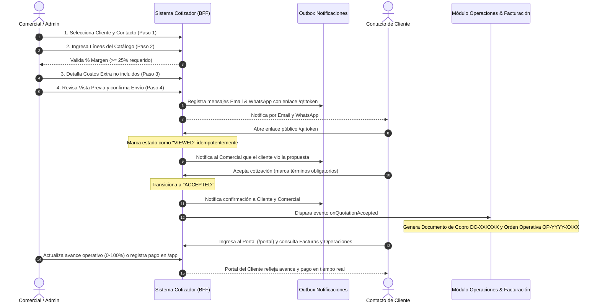
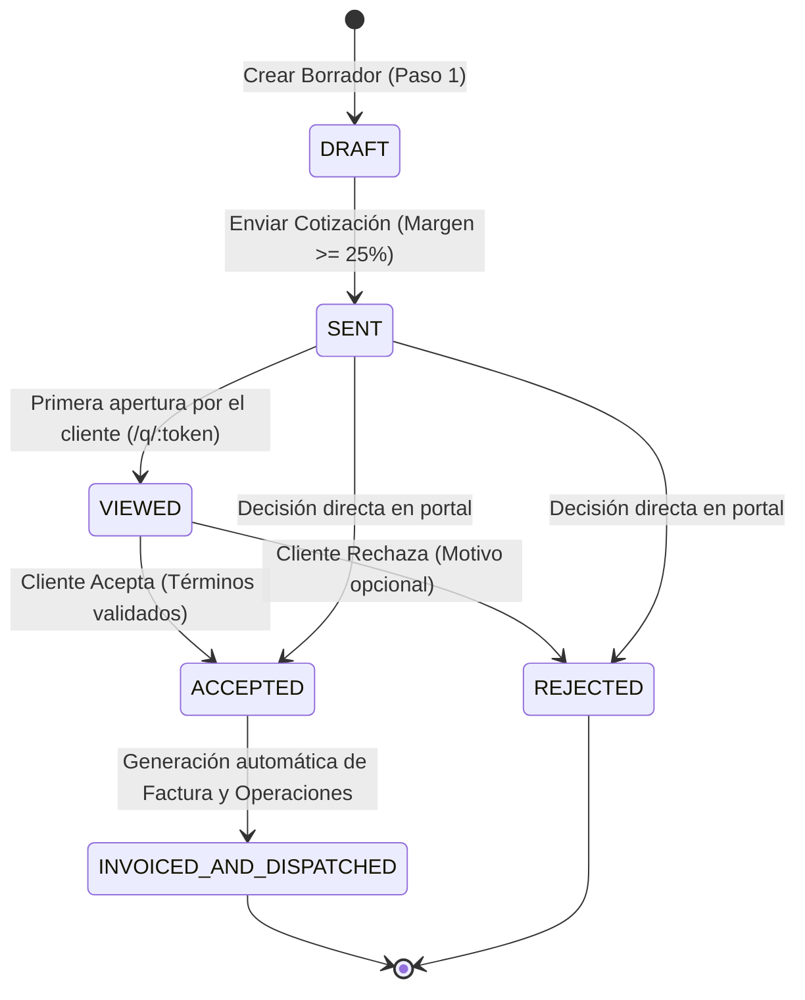
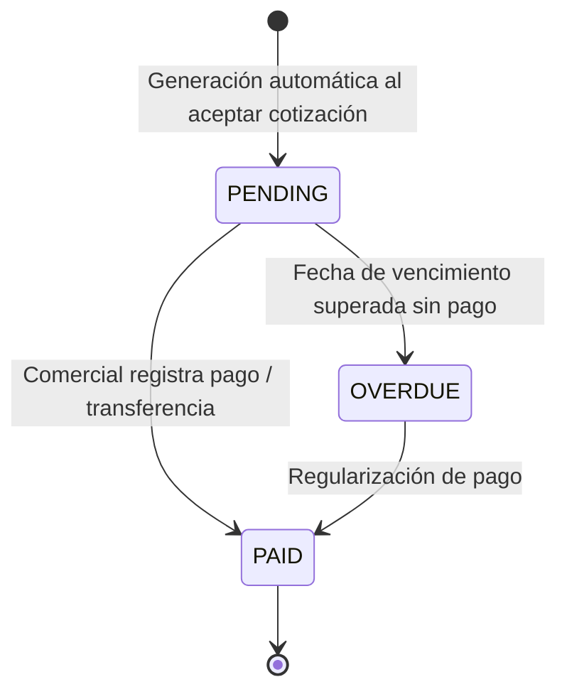
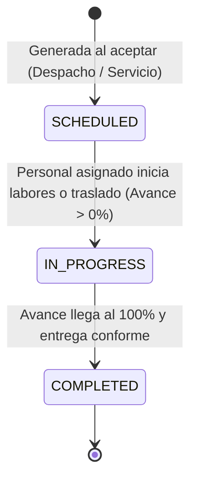
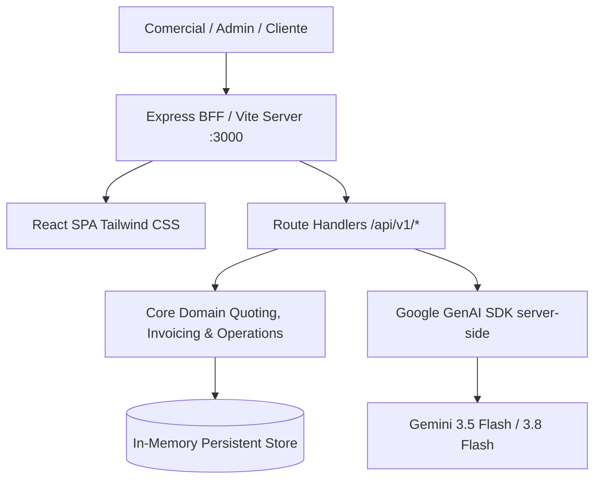
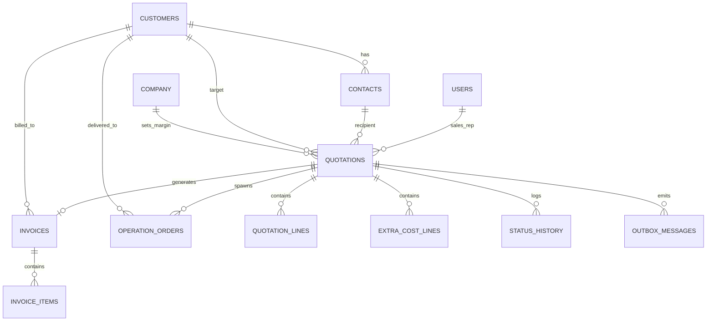

# Cotizador Online &mdash; Sistema Integral de Gestión de Cotizaciones y Portal de Clientes

Sistema web completo de nivel corporativo para la gestión centralizada de cotizaciones (proformas) de **productos y servicios**, diseñado para reemplazar hojas de cálculo de Excel sin control. Integra un **panel interno para comerciales y administradores**, un **portal de autoservicio para clientes** y un **login unificado**, con control estricto del **margen bruto comercial (mínimo 25%)**, trazabilidad de estados, asistente inteligente con **Gemini IA (Chat comercial y análisis de requerimientos)** y los módulos transversales post-aceptación de **Facturas** y **Operaciones**.

---

## Tabla de Contenidos
1. [Descripción General](#1-descripción-general)
2. [Objetivos de Negocio](#2-objetivos-de-negocio)
3. [Glosario y Lenguaje Ubicuo (Ubiquitous Language)](#3-glosario-y-lenguaje-ubicuo)
4. [Funcionalidades en Detalle, Pantalla por Pantalla](#4-funcionalidades-en-detalle-pantalla-por-pantalla)
   - 4.1 Login Unificado (`/login`)
   - 4.2 Dashboard del Panel Interno (`/app/dashboard`)
   - 4.3 Asistente de Cotización (Wizard de 4 Pasos)
   - 4.4 Vista Pública de Cotización (`/q/:token`)
   - 4.5 Portal del Cliente (`/portal`) con Facturas y Operaciones Habilitadas
   - 4.6 Módulos Transversales de Facturación y Operaciones (Panel Interno `/app`)
   - 4.7 Asistente con Gemini IA (Chat Comercial y Análisis de Documentos)
   - 4.8 Asignación del Equipo Comercial (Solo Administrador)
   - 4.9 Gestión Compartida de Clientes y Contactos (Admin & Panel Comercial)
   - 4.10 Logs de Auditoría y Exportación a CSV (`.csv`)
   - 4.11 Copia de Seguridad y Respaldo del Sistema (Backup & Restore)
   - 4.12 Gobierno Corporativo: Margen Mínimo Estático en Panel Comercial
   - 4.13 Diseño Ergonómico de Menús Laterales (Alturas Uniformes)
5. [Flujo de Proceso (Diagrama BPMN y Secuencia End-to-End)](#5-flujo-de-proceso)
6. [Máquinas de Estado del Sistema](#6-máquinas-de-estado-del-sistema)
   - 6.1 Ciclo de Vida de la Cotización
   - 6.2 Ciclo de Vida de la Factura
   - 6.3 Ciclo de Vida de la Orden Operativa (Despacho / Servicio)
7. [Regla de Margen (MarginPolicy)](#7-regla-de-margen)
8. [Productos y Servicios](#8-productos-y-servicios)
9. [Arquitectura (Hexagonal, DDD y ADRs)](#9-arquitectura)
10. [Modelo de Dominio y Agregados](#10-modelo-de-dominio-y-agregados)
11. [Base de Datos (Diagrama Entidad-Relación Integral)](#11-base-de-datos)
12. [Contrato de la API (OpenAPI 3.1 & BFF)](#12-contrato-de-la-api-openapi)
13. [Seguridad y Control de Acceso](#13-seguridad)
14. [Notificaciones (Outbox Pattern, Email & WhatsApp)](#14-notificaciones)
15. [Internacionalización y Modo de Tema (Claro / Oscuro / Sistema)](#15-internacionalización-y-modo-de-tema)
16. [Puesta en Marcha Paso a Paso](#16-puesta-en-marcha-paso-a-paso)
17. [Variables de Entorno](#17-variables-de-entorno)
18. [Scripts Disponibles](#18-scripts)
19. [Estrategia de Testing y TDD](#19-estrategia-de-testing-y-tdd)
20. [Estructura de Carpetas](#20-estructura-de-carpetas)
21. [Inventario de Datos Semilla y Mock Data (DATOS_SEMILLA.md)](#21-inventario-de-datos-semilla-y-mock-data)
22. [Guías para Extender el Sistema](#22-guías-para-extender-el-sistema)
23. [Convenciones de Código y Buenas Prácticas](#23-convenciones-de-código)
24. [Solución de Problemas (Troubleshooting) & FAQ](#24-solución-de-problemas-y-faq)
25. [Roadmap Futuro](#25-roadmap)

---

## 1. Descripción General

Tradicionalmente, las áreas comerciales emiten cotizaciones utilizando plantillas de Excel desconectadas. Esto genera errores graves en la operación corporativa:
- Ventas con márgenes inferiores al costo operativo real por falta de cálculo riguroso.
- Falta de visibilidad sobre cuándo un cliente revisó una propuesta.
- Discrepancias entre las listas de precios oficiales y lo ofrecido por cada vendedor.
- Clientes que pierden el historial de ofertas o no cuentan con un mecanismo formal para aceptar o rechazar.
- **Ruptura de continuidad operativa post-venta:** una vez aceptada la oferta, la emisión de facturas y el seguimiento de despachos o instalaciones de servicios se gestionan en silos desarticulados.

**Cotizador Online** resuelve este problema mediante una plataforma web unificada en TypeScript donde:
1. **El equipo comercial** elabora cotizaciones en un asistente de 4 pasos con validación matemática en tiempo real del margen de ganancia sobre el precio de venta (mínimo corporativo del 25%).
2. **Los clientes** reciben enlaces públicos seguros e interactivos (`/q/:token`) y disponen de un portal privado (`/portal`) para visualizar cotizaciones en calendario, timeline o listado, aceptando o rechazando formalmente.
3. **Continuidad Post-Aceptación (Coherencia Transversal):**
   - Cuando una cotización es aceptada, el sistema dispara automáticamente el evento de dominio `QuotationAccepted`, originando de forma inmediata el **Documento de Cobro** correlativo (`DC-XXXXXX`) y las **Órdenes de Operación** correspondientes (despacho físico de productos y/o ejecución técnica de servicios navales).
   - Tanto el **Portal del Cliente** como el **Panel Interno Comercial/Admin** comparten la misma fuente de verdad: los estados de pago de facturas y los porcentajes de avance de operaciones se sincronizan en tiempo real.
4. **El administrador** monitorea en un panel ejecutivo (`/app/dashboard`) la rentabilidad consolidada, el rendimiento individual de cada comercial, el balance entre productos y servicios, y los flujos financieros de cobranza y despacho.

---

## 2. Objetivos de Negocio

| N.º | Objetivo de Negocio | Cómo lo resuelve la plataforma |
|---|---|---|
| **1** | **Control por comercial** | Panel analítico que registra cuántas cotizaciones genera cada asesor, su tasa de cierre y su margen promedio. Regla de propiedad de datos donde cada comercial accede a sus cotizaciones. |
| **2** | **Control del estado** | El cliente tiene el control decisivo: la primera apertura marca automáticamente como `Vista` (notificando al vendedor), y el cliente formaliza la decisión con `Aceptar` o `Rechazar`. |
| **3** | **Interacción del cliente** | Portal de autoservicio sin barreras y enlaces públicos responsivos que no requieren autenticación previa para decidir. |
| **4** | **Control de margen** | La regla de negocio `MarginPolicy` impide el avance del borrador o el envío de cualquier propuesta que no alcance el margen mínimo configurado (25%). |
| **5** | **Control de la cartera** | Los clientes pertenecen a la empresa y no al comercial individual. Solo el rol `Admin` puede aplicar bajas lógicas (`deleted_at`). |
| **6** | **Trazabilidad Post-Venta (Facturas y Operaciones)** | Habilitación plena y sincronizada de los módulos de Facturación y Operaciones en ambos portales (Cliente e Interno), eliminando estados "próximamente" y garantizando visibilidad compartida de comprobantes, pagos, guías y avances. |

---

## 3. Glosario y Lenguaje Ubicuo (Ubiquitous Language)

| Término en Español | Código (Inglés) | Definición en el Dominio |
|---|---|---|
| Cotización | `Quotation` | Documento comercial formal que contiene líneas cotizadas, costos extra, estados y totales calculados. |
| Comercial | `SalesRep` | Usuario interno de la empresa asignado a la elaboración y seguimiento de cotizaciones. |
| Cliente | `Customer` | Persona jurídica o empresa a la que se le presentan propuestas comerciales. |
| Contacto | `Contact` | Persona natural dentro de la empresa cliente con la que se interactúa comercialmente. |
| Ítem de catálogo | `CatalogItem` | Elemento base de la lista de precios, discriminado en `Product` o `Service`. |
| Producto | `Product` | Bien físico identificable por SKU, marca y unidad de medida entera o decimal. |
| Servicio | `Service` | Prestación intangible medida en unidades de tiempo (hora, mes) o alcance (global). |
| Costo extra | `ExtraCost` | Costo adicional informativo (flete, viáticos) que se muestra al cliente sin sumar al total de venta. |
| Margen | `Margin` | Porcentaje de ganancia bruta sobre el precio de venta: `(precio - costo) / precio * 100`. |
| Enviada | `Sent` | Estado formal tras el despacho de la cotización; genera el enlace público y notificaciones. |
| Vista | `Viewed` | Estado transicional que se activa de forma idempotente la primera vez que el cliente abre la cotización. |
| Aceptada | `Accepted` | Estado final exitoso donde el cliente aprueba la propuesta y acepta los términos comerciales. |
| Rechazada | `Rejected` | Estado final desestimado con registro opcional del motivo de desestimación. |
| Factura | `Invoice` | Comprobante fiscal y comercial emitido tras la aceptación, con desglose de ítems, impuestos, fecha de vencimiento y estado de cobro. |
| Orden Operativa | `OperationOrder` | Orden de ejecución generada automáticamente tras la aceptación, categorizada como Despacho de Productos o Ejecución de Servicios. |
| Guía de Remisión | `GuideNumber` | Identificador de traslado físico de mercancías emitido para órdenes de despacho de productos. |
| Avance Operativo | `ProgressPct` | Porcentaje de cumplimiento (0 a 100%) gestionado por el equipo operativo y visible en tiempo real para el cliente. |

---

## 4. Funcionalidades en Detalle, Pantalla por Pantalla

### 4.1 Login Unificado (`/login`)
- **Acceso único** para Admin, Comerciales y Contactos de clientes.
- Redirección automática según rol: Administradores y Comerciales van a `/app/dashboard`, mientras que Contactos de Clientes son dirigidos a `/portal/dashboard`.
- En entorno de desarrollo incluye botones de acceso rápido de 1 clic con credenciales pre-cargadas para los 3 roles.

### 4.2 Dashboard del Panel Interno (`/app/dashboard`)
- Tarjetas KPI: Total de Aceptadas, Rechazadas, Enviadas, Vistas y Borradores.
- Reporte comparativo de Asesores Comerciales: volumen de cotizaciones, ventas aceptadas, margen promedio y tasa de cierre.
- Comparativa Productos vs Servicios: desglose de ventas, costo y margen bruto.
- Resumen financiero de facturación acumulada y órdenes operativas en curso.

### 4.3 Asistente de Cotización (Wizard de 4 Pasos)
1. **Paso 1 (Cliente & Contacto):** Selección de la empresa y contacto destinatario. Los datos fiscales (RUT, dirección) se presentan en modo solo lectura.
2. **Paso 2 (Detalle & Margen):**
   - Buscador en catálogo filtrable por Producto o Servicio.
   - Columnas reactivas con cálculo bidireccional entre Margen % y Precio Unitario.
   - Si el margen consolidado es menor al 25%, el botón "Siguiente" queda bloqueado y se muestra una alerta con el **faltante en dinero** necesario para alcanzar el margen.
3. **Paso 3 (Costos Extra):** Permite registrar conceptos complementarios (ej. viáticos, instalación) sin que sumen al valor cotizado ni distorsionen el margen.
4. **Paso 4 (Vista Previa & Envío):**
   - Vista preliminar exacta con líneas agrupadas en "Productos" y "Servicios".
   - Edición de carta de presentación, notas, términos y validez en días.
   - Botón de guardado como borrador y botón de **Envío formal** con diálogo de confirmación.

### 4.4 Vista Pública de Cotización (`/q/:token`)
- Acceso directo sin contraseña mediante token criptográfico seguro.
- La primera apertura ejecuta el evento de dominio `QuotationViewed`, notificando de inmediato al vendedor por email y WhatsApp.
- Checkbox obligatorio de aceptación de términos y botones de Aceptar o Rechazar.
- Al aceptar, se dispara la emisión instantánea de la factura y de las órdenes operativas.
- Opciones de descarga e impresión formal a PDF.

### 4.5 Portal del Cliente (`/portal`) con Facturas y Operaciones Habilitadas
El portal corporativo para clientes (`/portal`) ha habilitado al 100% sus módulos funcionales, eliminando cualquier etiqueta de "próximamente" y ofreciendo una experiencia integral:

1. **Panel General (`/portal/dashboard`):**
   - Tarjetas de resumen con cotizaciones activas, aceptadas, total facturado y órdenes operativas en progreso.
   - Accesos directos a comprobantes pendientes de pago y entregas programadas.
2. **Mis Cotizaciones (`/portal/quotations`):**
   - Listado completo de propuestas recibidas con filtros por estado y buscador.
   - Acceso a la vista ejecutiva con capacidad de aceptar o rechazar en línea.
3. **Calendario Mensual (`/portal/calendar`):**
   - Vista de calendario interactiva con selector de mes y año.
   - Marcadores coloreados por estado para identificar fechas de emisión y vencimiento de ofertas.
4. **Línea de Tiempo (`/portal/timeline`):**
   - Registro cronológico interactivo de todas las interacciones comerciales del cliente.
5. **Facturas (`/portal/invoices`):**
   - Consulta centralizada de facturas emitidas a nombre de la empresa cliente.
   - Indicadores de estado: `PAGADA` (esmeralda), `PENDIENTE` (ámbar) y `VENCIDA` (rojo).
   - Tarjetas informativas con subtotal, impuesto (IGV 18%) y total a pagar.
   - **Modal de Detalle de Factura:** desglose línea por línea de productos y servicios adquiridos, condiciones de pago (ej. 50% anticipo y 50% contra entrega) y botón de **Impresión / Exportación a PDF**.
6. **Operaciones (`/portal/operations`):**
   - Seguimiento logístico y técnico en tiempo real para todos los pedidos derivados de cotizaciones aceptadas.
   - **Despacho de Productos:** número de orden, guía de remisión asociada (`T001-XXXXXX`), transportista, dirección de entrega fiscal y barra de progreso.
   - **Ejecución de Servicios:** alcance del servicio, ingeniero o especialista TI asignado, fecha agendada y porcentaje de avance (0% a 100%).

### 4.6 Módulos Transversales de Facturación y Operaciones (Panel Interno `/app`)
Para garantizar una estricta coherencia entre lo que ve el cliente y lo que administra la empresa:

1. **Facturación & Cobranzas (`/app/invoices`):**
   - Tarjetas métricas ejecutivas: Total Facturado, Total Cobrado y Saldo Pendiente de Cobro.
   - Listado maestro de facturas emitidas con filtro por estado (`TODAS`, `PENDIENTES`, `PAGADAS`, `VENCIDAS`).
   - **Acción de Cobranza:** botón directo para registrar el pago de cualquier factura pendiente (`Marcar como Pagada`), especificando el método de pago confirmado (ej. Transferencia Bancaria).
   - Trazabilidad con la cotización origen: enlace directo para auditar la cotización que generó la factura.
2. **Operaciones & Despacho (`/app/operations`):**
   - Tablero de control de entregas de productos y ejecuciones de servicios técnicos.
   - **Slider de Avance en Tiempo Real:** permite al coordinador de operaciones ajustar el porcentaje de avance (de 0% a 100%) con retroalimentación inmediata hacia el portal del cliente.
   - **Gestión de Estados Operativos:** transición fluida entre `PROGRAMADA`, `EN PROCESO` y `COMPLETADA`.
   - Asignación de personal operativo responsable y actualización de números de guías de remisión.

### 4.7 Asistente con Gemini IA
- **Chat Multiturno:** asistente comercial y técnico para resolver dudas sobre propuestas, cálculos y términos.
- **Análisis de Documentos e Imágenes:** análisis de diagramas técnicos y solicitudes de cotización mediante modelos multimodales de Gemini.

### 4.8 Asignación del Equipo Comercial (Solo Administrador)
- **Control Centralizado de Asesores:** la Gerencia / Administrador define qué personas integran el equipo comercial y gestionan cuentas de clientes.
- **Control de Acceso Inmediato:** botón toggle para habilitar o suspender de inmediato el ingreso al Panel Comercial para cualquier asesor.
- **Simulación de Sesión:** botón de prueba para cambiar rápidamente la perspectiva y validar la interfaz como dicho comercial.

### 4.9 Gestión Compartida de Clientes y Contactos (Admin & Panel Comercial)
- **Cartera Corporativa:** Tanto el Administrador como los Asesores Comerciales pueden añadir nuevos clientes (validando RUT único con formato chileno y dígito verificador módulo 11) y editar datos de contacto y dirección. **Solo el Administrador** puede aplicar bajas lógicas seguras (`deleted_at`), protegiendo la integridad de la cartera corporativa.
- **Gestión Completa de Contactos:** Alta rápida dentro del cliente, edición de datos (nombre, cargo, correo, teléfono) y botón **"Enviar enlace de acceso al portal"** que genera un token seguro y encola la invitación directamente en la bandeja de salida (Outbox). Solo el Administrador puede dar de baja contactos.

### 4.10 Logs de Auditoría y Exportación a CSV (.csv)
- **Trazabilidad Compartida y Transparente:** bitácora viva que registra todas las decisiones y modificaciones ejecutadas por el Administrador y los Comerciales sobre:
  - Catálogo de productos y servicios (precios, costos, descripciones y bajas).
  - Clientes y contactos de clientes.
  - Parámetros institucionales y margen mínimo corporativo.
  - Asignación y suspensión de asesores comerciales.
- **Exportación a CSV:** botón dedicado en la cabecera que descarga el archivo `.csv` filtrado según los criterios activos (ámbito, rol del actor o búsqueda), codificado con **Byte Order Mark UTF-8 (`\uFEFF`)** para apertura nativa e inmediata en Microsoft Excel, Google Sheets y LibreOffice Calc.

### 4.11 Copia de Seguridad y Respaldo del Sistema (Backup & Restore)
- **Instantánea Integral en JSON (`GET /api/v1/system/backup`):** genera un archivo de respaldo que contiene la totalidad de las colecciones de la base de datos (empresa, usuarios, categorías, catálogo, clientes, contactos, cotizaciones, facturas, órdenes de operación, outbox y logs de auditoría), junto con metadatos de versión y conteo de entidades.
- **Restauración Segura con RBAC (`POST /api/v1/system/restore`):** función protegida con clave y rol exclusivo de Administrador. Cuenta con validación exhaustiva de la estructura JSON y un **modal interactivo de confirmación previa** que desglosa el contenido a restaurar antes de proceder.

### 4.12 Gobierno Corporativo: Margen Mínimo Estático en Panel Comercial
- **Solo Administrador:** el Portal Administrador es la única entidad autorizada para recalibrar el Margen Mínimo Corporativo exigido.
- **Panel Comercial Estático:** para los asesores comerciales, la sección «Empresa y Margen Mínimo» es 100% estática y de solo lectura (`🔒 Estático &bull; Solo Lectura`). El endpoint backend rechaza con `403 Forbidden` cualquier intento de modificación no autorizado.

### 4.13 Diseño Ergonómico de Menús Laterales
- **Alturas Uniformes Estandarizadas:** todos los botones y secciones de navegación lateral de ambos portales (`InternalApp` y `ClientPortal`) tienen una altura uniforme garantizada de 40px (`h-10 min-h-[40px]`), asegurando una experiencia visual balanceada, ergonómica y libre de saltos de línea.

## 5. Flujo de Proceso

El flujo de información y estados modela la interacción completa desde la creación del borrador hasta la facturación y despacho:



---

## 6. Máquinas de Estado del Sistema

### 6.1 Ciclo de Vida de la Cotización



### 6.2 Ciclo de Vida de la Factura



### 6.3 Ciclo de Vida de la Orden Operativa



---

## 7. Regla de Margen (MarginPolicy)

El sistema opera bajo el **margen bruto comercial sobre el precio de venta** como único criterio corporativo:

$$\text{Margen \%} = \frac{\text{Precio} - \text{Costo}}{\text{Precio}} \times 100$$

### Recálculo de Precio a partir del Margen Objetivo:
$$\text{Precio} = \frac{\text{Costo}}{1 - (\text{Margen} / 100)}$$
*Nota:* El precio resultante siempre se redondea hacia arriba al céntimo superior (`Decimal.ROUND_UP`) para garantizar matemáticamente que el margen nunca quede por debajo del umbral objetivo debido a decimales residuales.

### Faltante en caso de Margen Insuficiente:
$$\text{Faltante} = \frac{\text{Costo Total}}{1 - (\text{Mínimo} / 100)} - \text{Venta Total}$$

### Ejemplos Numéricos de Verificación:

#### Caso 1: Margen Insuficiente con Faltante
- Costo Total: **S/ 700.00**
- Precio de Venta: **S/ 874.02**
- Margen Mínimo: **25.00%**
- Venta requerida: $700 / (1 - 0.25) = 933.333... \to \text{S/ } 933.34$
- **Faltante exacto:** $933.333... - 874.02 = \mathbf{S/\ 59.32}$
- *Resultado:* El asistente bloquea el avance del Paso 2 y muestra la alerta en rojo con el faltante.

#### Caso 2: Margen del 25% en todas las líneas
- Línea 1: Costo $ 100.000, Margen 25% $\to$ Precio $ 133.334 CLP (Margen real: 25.003%)
- *Resultado:* Pasa exitosamente gracias al redondeo hacia arriba al peso entero.

#### Caso 3: Compensación de líneas
- Línea 1 (Servicio): Costo $ 90.000, Venta $ 100.000 (Margen 10%)
- Línea 2 (Producto): Costo $ 60.000, Venta $ 100.000 (Margen 40%)
- Total Venta: $ 200.000, Total Costo: $ 150.000. Ganancia: $ 50.000.
- Margen consolidado: $(50.000 / 200.000) \times 100 = \mathbf{25.00\%}$.
- *Resultado:* Pasa exitosamente porque la validación aplica sobre el consolidated total.

---

## 8. Productos y Servicios

| Atributo | Producto (`PRODUCT`) | Servicio (`SERVICE`) |
|---|---|---|
| **Identificador** | **SKU** único obligatorio (ej. `NAV-PL-A36-12`) | Código opcional (ej. `ING-EST-01`) |
| **Unidad de Medida** | UND, CAJA, KG, M, M2, L | HORA, DIA, MES, VISITA, GLOBAL |
| **Validación de Cantidad** | Entera para UND o CAJA; decimal para otras | Decimal siempre permitido (ej. 1.5 horas) |
| **Información adicional** | Marca | Duración estimada |
| **Presentación** | Agrupados en sección "Productos" en vista y PDF | Agrupados en sección "Servicios" en vista y PDF |
| **Operación derivada** | Genera orden de tipo `PRODUCT_DELIVERY` con guía | Genera orden de tipo `SERVICE_EXECUTION` con técnico |
| **Snapshot** | Las cotizaciones congelan el nombre, costo y precio al cotizar | Igual snapshot histórico |

---

## 9. Arquitectura

### Diagrama de Contexto y Contenedores (C4)


### Arquitectura del Sistema
```
src/
  ├── server/             # Backend Express (BFF montado en server.ts)
  │     ├── routes/       # Endpoints REST (auth, quotations, customers, catalog, dashboard, etc.)
  │     ├── middleware/   # Autenticación Bearer, rate limiting, control de acceso RBAC
  │     ├── repositories/ # Repositorios y adaptadores de datos
  │     ├── services/     # NumberingService, AuditService, OutboxService
  │     └── schemas.ts    # Validación estricta con esquemas Zod
  ├── shared-kernel/      # Núcleo de dominio compartido entre cliente y servidor
  │     ├── pricing/      # computeTotals canónico (Decimal.js, margen, IVA 19%)
  │     ├── permissions.ts# Matriz de permisos canónica por rol
  │     ├── formatMoney.ts# Formateo único de moneda CLP sin decimales
  │     ├── rut.ts        # Validación de RUT chileno con módulo 11
  │     └── value-objects.ts # Validaciones de dominio (Money, Percentage, Quantity)
  ├── ui/                 # Frontend React 19 + Tailwind CSS 4
  │     ├── components/   # InternalApp, ClientPortal, PublicQuotationView, QuotationWizard
  │     └── api.ts        # Cliente API tipado con Bearer tokens
  └── modules/            # Tipos de dominio y almacenamiento de datos base
```

---

## 10. Modelo de Dominio y Agregados

### Agregado `Quotation`
- **Identificador:** UUID / `COT-XXXXXX`
- **Entidades hijas:** `QuotationLine[]`, `ExtraCostLine[]`, `StatusHistoryEntry[]`
- **Value Objects:** `Money`, `Percentage`, `Quantity`, `PublicToken`
- **Invariantes protegidas:**
  1. `Quotation.marginPct >= minMarginPct` para salir de Draft.
  2. Cotizaciones solo son editables en estado `DRAFT`.
  3. Toda aceptación exige haber marcado `termsAccepted == true`.
  4. Los costos extra no influyen en el importe total ni en el margen.

### Agregado `Invoice` (Documento de Cobro)
- **Identificador:** UUID / `DC-XXXXXX`
- **Atributos:** `quotationId`, `customerId`, `subtotal`, `taxAmount`, `total`, `status` (`PENDING`, `PAID`, `OVERDUE`), `paymentMethod`, `paymentTerms`.
- **Entidades hijas:** `InvoiceItem[]`

### Agregado `OperationOrder`
- **Identificador:** UUID / `OP-2026-XXXX`
- **Atributos:** `quotationId`, `customerId`, `type` (`PRODUCT_DELIVERY`, `SERVICE_EXECUTION`), `status` (`SCHEDULED`, `IN_PROGRESS`, `COMPLETED`), `progressPct` (0 a 100), `assignedStaff`, `guideNumber`, `deliveryAddress`.

---

## 11. Base de Datos



---

## 12. Contrato de la API (OpenAPI)

El contrato formal OpenAPI 3.1 se ubica en `contracts/openapi.yaml` y se puede consultar interactivamente en vivo mediante Swagger UI en:
**`http://localhost:3000/api-docs`**

### Endpoints Principales:

| Método | Endpoint | Descripción |
|---|---|---|
| `POST` | `/api/v1/auth/login` | Login unificado para Admin, Comercial y Contactos |
| `GET` | `/api/v1/quotations` | Listado de cotizaciones filtrable |
| `POST` | `/api/v1/quotations` | Crear nuevo borrador (Paso 1) |
| `PUT` | `/api/v1/quotations/:id/lines` | Reemplazar líneas con validación estricta de margen (Paso 2) |
| `POST` | `/api/v1/quotations/:id/send` | Enviar cotización formal (Paso 4) |
| `GET` | `/api/v1/public/quotations/:token` | Consulta pública y marca automática de `VIEWED` |
| `POST` | `/api/v1/public/quotations/:token/accept` | Aceptación del cliente y generación automática de factura y operaciones |
| `GET` | `/api/v1/invoices` | Listado de facturas en el panel comercial |
| `PATCH` | `/api/v1/invoices/:id` | Registrar pago de factura (`PAID`) |
| `GET` | `/api/v1/portal/invoices` | Listado de facturas del cliente autenticado |
| `GET` | `/api/v1/operations` | Listado de órdenes operativas en panel comercial |
| `PATCH` | `/api/v1/operations/:id` | Actualizar avance (0-100%), estado o guía |
| `GET` | `/api/v1/portal/operations` | Listado de órdenes operativas del cliente autenticado |
| `GET` | `/api/v1/audit-logs` | Bitácora de auditoría y trazabilidad con filtros |
| `GET` | `/api/v1/audit-logs/export.csv` | Exportación de registros de auditoría a CSV con UTF-8 BOM |
| `GET` | `/api/v1/system/backup` | Descarga de copia de respaldo completa en JSON |
| `POST` | `/api/v1/system/restore` | Restauración de base de datos desde respaldo (Solo Admin) |

### Comandos cURL de prueba rápida:

#### 1. Iniciar sesión como Comercial y obtener token Bearer:
```bash
TOKEN=$(curl -s -X POST http://localhost:3000/api/v1/auth/login \
  -H "Content-Type: application/json" \
  -d '{"email": "smorales@mlingenieria.cl", "password": "sales123"}' | jq -r '.token')
```

#### 2. Exportar Logs de Auditoría a CSV (Solo Admin):
```bash
ADMIN_TOKEN=$(curl -s -X POST http://localhost:3000/api/v1/auth/login \
  -H "Content-Type: application/json" \
  -d '{"email": "admin@mlingenieria.cl", "password": "admin123"}' | jq -r '.token')

curl -s "http://localhost:3000/api/v1/audit-logs/export-csv?entity=CATALOG" \
  -H "Authorization: Bearer $ADMIN_TOKEN" -o logs-catalogo.csv
```

#### 3. Descargar Copia de Respaldo Completa (Backup JSON):
```bash
curl -s http://localhost:3000/api/v1/system/backup \
  -H "Authorization: Bearer $ADMIN_TOKEN" -o backup-sistema.json
```

#### 4. Restaurar Base de Datos del Sistema (Solo Administrador):
```bash
curl -X POST http://localhost:3000/api/v1/system/restore \
  -H "Content-Type: application/json" \
  -H "Authorization: Bearer $ADMIN_TOKEN" \
  -d @backup-sistema.json
```

#### 5. Consultar Documentos de Cobro del Sistema:
```bash
curl -s http://localhost:3000/api/v1/invoices \
  -H "Authorization: Bearer $ADMIN_TOKEN" | jq .
```

#### 6. Actualizar Avance de una Orden Operativa:
```bash
curl -X PATCH http://localhost:3000/api/v1/operations/op-1 \
  -H "Content-Type: application/json" \
  -H "Authorization: Bearer $ADMIN_TOKEN" \
  -d '{"progressPct": 85, "status": "IN_PROGRESS", "guideNumber": "GD-2026-000160"}'
```

---

## 13. Seguridad y Control de Acceso

- **Autenticación con JWT Bearer y PBKDF2:** Autenticación sin estado firmada criptográficamente con HMAC SHA-256 (`SESSION_SECRET`). Las contraseñas se almacenan con salt individual y hash PBKDF2/SHA-512 (S1, S9).
- **Autorización Deny-by-Default:** Comprobación estricta de roles (`ADMIN`, `SALES_REP`, `CUSTOMER_CONTACT`) en cada endpoint mediante middleware Express (`authenticateStaff`, `requireAdmin`, `authenticateClient`).
- **Aislamiento Multitenant en Portal:** El portal no confía en `?customerId=` del cliente; la identidad de la empresa y del contacto se deriva exclusivamente del token verificado de la sesión (S3).
- **Respuesta Pública Sanitizada:** La vista pública (`/api/v1/public/quotations/:token`) excluye estrictamente costos unitarios, margen bruto, notas internas del comercial y datos de otros clientes (S4).
- **Recálculo Autorizado en Servidor:** El servidor nunca confía en costos ni subtotales enviados por el cliente; los recalcula desde el catálogo oficial mediante `computeTotals` y valida el margen corporativo mínimo mediante `MarginPolicy` (S5).
- **Sanitización CSV (Anti-Formula Injection):** La exportación de logs de auditoría escapa celdas que inician con `=`, `+`, `-`, `@` anteponiendo comilla simple según OWASP y RFC 4180 (S9).
- **Identificadores Criptográficos Anti-Colisión:** Todas las nuevas entidades generan IDs basados en UUIDv4 (`crypto.randomUUID()`), eliminando el defecto de colisión por `Date.now()` concurrente (S8).

---

## 14. Notificaciones (Outbox Pattern)

Toda transición de estado crítica genera un mensaje en la tabla `outbox_messages` dentro de la misma transacción:
- **Al Enviar (`QuotationSent`):** Email y WhatsApp al contacto con el enlace `/q/:token`.
- **Al Visualizar (`QuotationViewed`):** Email y WhatsApp al Comercial alertándolo de que el cliente está revisando la propuesta.
- **Al Aceptar (`QuotationAccepted`):** Email de felicitación al cliente y alerta al comercial y a operaciones para coordinar facturación y despacho.
- **Al Rechazar (`QuotationRejected`):** Notificación al comercial con el motivo para su análisis y posible re-cotización.

---

## 15. Modo de Tema UX/UI (Tema Claro, Oscuro y Detección del Sistema Operativo)
La plataforma cuenta con un sistema reactivo de temas basado en la preferencia del usuario y de su sistema operativo:

- **Variable de Control de Tema (`ThemeMode`):**
  - `'system'`: **Modo por defecto.** La aplicación consulta la preferencia del sistema operativo mediante el media query `window.matchMedia('(prefers-color-scheme: dark)')`.
    - Si el sistema operativo del usuario está en **Modo Oscuro**, la interfaz aplica automáticamente la paleta oscura (`dark`).
    - Si el sistema operativo del usuario está en **Modo Claro**, la interfaz aplica automáticamente la paleta clara (`light`).
    - **Escucha Reactiva:** Se suscribe al evento `change` del media query para cambiar el tema en tiempo real si el usuario cambia el tema de su sistema operativo en Windows, macOS, Linux, iOS o Android.
  - `'light'`: Fuerza el tema claro independientemente de la configuración del sistema.
  - `'dark'`: Fuerza el tema oscuro independientemente de la configuración del sistema.

- **Componente Visual `ThemeSelector`:**
  - Selector con iconos de Monitor (`Sistema`), Sol (`Claro`) y Luna (`Oscuro`).
  - Presente en:
    1. **Login Unificado (`/login`)** en la barra superior.
    2. **Panel Interno Comercial/Admin (`/app`)** en la cabecera principal.
    3. **Portal del Cliente (`/portal`)** junto al selector de idiomas.
    4. **Vista Pública de Cotización (`/q/:token`)** en la barra superior flotante.
  - Persistencia en el navegador mediante `localStorage.getItem('cotizador_theme_mode')`.

- **Integración con Tailwind CSS y DOM:**
  - Aplica la clase `.dark`, el atributo `data-theme="dark"` y la propiedad estándar CSS `color-scheme: dark` al elemento raíz `<html>` (`document.documentElement`), garantizando consistencia en scrollbars, selects y componentes nativos.

---

## 16. Puesta en Marcha Paso a Paso

1. **Requisitos:** Node.js 20+ y npm/pnpm.
2. **Instalación:**
   ```bash
   npm install
   ```
3. **Ejecución en Desarrollo (Puerto 3000):**
   ```bash
   npm run dev
   ```
4. **Abrir en el Navegador:**
   - Aplicación: `http://localhost:3000`
   - Documentación Swagger: `http://localhost:3000/api-docs`

### Credenciales de Demostración:
- **Administrador General:** `admin@mlingenieria.cl` / `admin123` (Acceso al panel completo, gestión de usuarios, cobranzas, operaciones, configuración de empresa y margen mínimo)
- **Asesor Comercial:** `smorales@mlingenieria.cl` / `sales123` (Elaboración de cotizaciones, cartera propia, seguimiento y órdenes operativas asignadas)
- **Contacto Cliente (Austral Salmón & Mar SpA):** `mbarrientos@australsalmon.cl` / `cliente123` (Acceso al portal cliente multitenant con documentos de cobro, cotizaciones y peritajes en curso)

---

## 17. Variables de Entorno

| Variable | Requerida | Propósito |
|---|---|---|
| `GEMINI_API_KEY` | Sí | Clave para llamadas a la API de Google Gemini (Chat y análisis de requerimientos) |
| `PORT` | Opcional | Puerto del servidor (por defecto 3000) |
| `NODE_ENV` | Opcional | `development` o `production` |

---

## 18. Scripts

- `npm run dev`: Inicia el servidor full-stack en `server.ts` con Vite montado en dev en el puerto 3000.
- `npm run build`: Genera la compilación de producción del frontend.
- `npm run lint`: Valida tipos y sintaxis con TypeScript (`tsc --noEmit`).
- `npm run test`: Ejecuta los tests unitarios de la regla de margen con Vitest.

---

## 19. Estrategia de Testing y TDD

La suite de pruebas unitarias evalúa con rigurosidad:
- Recálculo exacto de precios con redondeo hacia arriba.
- Validación estricta del 25% de margen y cálculo exacto de faltantes.
- Restricción de cantidades enteras en productos y decimales en servicios.

Para ejecutar los tests:
```bash
npm run test
```

---

## 20. Estructura de Carpetas

```
├── contracts/
│   └── openapi.yaml           # Especificación OpenAPI 3.1 oficial (incluye Invoices y Operations)
├── src/
│   ├── modules/               # Bounded contexts (Arquitectura hexagonal)
│   │   ├── types.ts           # Modelos y contratos de dominio (Quotation, Invoice, OperationOrder)
│   │   └── db/store.ts        # Persistencia en memoria, seed data y trigger onQuotationAccepted
│   ├── shared-kernel/         # Value objects y lógica de precios
│   │   ├── Result.ts
│   │   ├── value-objects.ts
│   │   └── pricing/MarginPolicy.ts
│   ├── ui/                    # Capa de presentación React
│   │   ├── api.ts             # Cliente HTTP para BFF
│   │   ├── theme.tsx          # Gestión de temas Claro/Oscuro/Sistema (prefers-color-scheme)
│   │   └── components/
│   │       ├── Skeleton.tsx          # Componentes Skeleton para feedback visual de carga
│   │       ├── CommonBadges.tsx
│   │       ├── QuotationWizard.tsx
│   │       ├── PublicQuotationView.tsx
│   │       ├── ClientPortal.tsx      # Portal cliente con Facturas y Operaciones
│   │       └── AiAssistant.tsx       # Asistente Gemini (Chat y Análisis)
│   ├── App.tsx                # Enrutador principal y login unificado
│   ├── main.tsx
│   └── index.css
├── server.ts                  # Servidor Express BFF, API routes y proxy de Gemini
├── package.json
├── DATOS_SEMILLA.md           # Registro exhaustivo de todos los datos semilla y falsos del sistema
└── README.md
```

---

## 21. Inventario de Datos Semilla y Mock Data (DATOS_SEMILLA.md)

Para garantizar total transparencia sobre qué información es simulada y qué información es generada por usuarios reales, la aplicación incluye el archivo oficial **[`DATOS_SEMILLA.md`](./DATOS_SEMILLA.md)** con el desglose pormenorizado de todos los datos ficticios precargados en memoria:

### Resumen del Inventario Simulado (Ingeniería y Servicios Marítimos en Chile):
- **Empresa Emisora Ficticia:** `M&L Ingeniería Naval SpA` (RUT simulado `77.892.410-K`, Puerto Montt, Región de Los Lagos, margen mínimo obligatorio del 28.0%, moneda CLP con IVA 19%).
- **5 Cuentas Demo:** 1 Administradora / Gerente General (`admin@mlingenieria.cl`), 3 Ingenieros de Proyectos / Comerciales (`smorales@mlingenieria.cl`, `csoto@mlingenieria.cl`, `fmunoz@mlingenieria.cl`) y 1 Contacto de Cliente (`mbarrientos@australsalmon.cl`).
- **5 Categorías de Ingeniería:** Diseño y Planos Navales, Estudios de Estabilidad y Arqueo, Cálculos y Análisis Técnicos, Inspecciones Técnicas y Asesoría, Apoyo Técnico a Obra y Suministros.
- **14 Ítems en Catálogo:** 6 suministros y materiales navales certificados (ánodos, planchas de acero grado A, válvulas de fondo, bombas) y 8 servicios de ingeniería y peritaje (estudios de estabilidad DIRECTEMAR, pruebas de inclinación, planos navales, cálculo de escantillonado).
- **5 Clientes Corporativos Chilenos:** Austral Salmón & Mar SpA, Naviera y Transportes del Sur Austral Ltda., Astillero y Maestranza Tenglo SpA, Pesquera Reloncaví & Patagonia SpA y Servicios Marítimos y Cabotaje Chiloé Ltda. (con RUTs chilenos y domicilios en la zona sur austral).
- **6 Contactos Clave:** Interlocutores con cargos ejecutivos, correos y números móviles chilenos (+56 9).
- **30 Cotizaciones Semilla:** Numeración `COT-000001` a `COT-000030` valorizadas en CLP netos más IVA 19%, con márgenes >= 28%, viáticos en terreno y tokens públicos `tok_...`.
- **5 Facturas Electrónicas Chilenas:** Folios `FE-000142` a `FE-000168` con estados `PAID`, `PENDING` y `OVERDUE`.
- **5 Órdenes Operativas y de Peritaje:** Pruebas de inclinación en varadero, modelado hidrostático 3D, inspección de soldadura en casco y expedientes DIRECTEMAR con avance del 20% al 100%.

### Criterio de Identificación: Falso vs. Real
- **Datos Semilla (Falsos):** Utilizan prefijos estáticos cortos con identificadores numéricos simples: `quot-1`, `cust-01`, `cont-01`, `prod-01`, `serv-01`, `inv-01`, `op-01`.
- **Datos Reales creados en tiempo de ejecución:** Utilizan identificadores dinámicos basados en marcas de tiempo Unix de milisegundos: `quot-174...`, `cust-174...`, `inv-174...`, `op-174...`.

---

## 22. Guías para Extender el Sistema

### Agregar un nuevo servicio o producto al catálogo:
1. Diríjase a la sección "Catálogo" en el panel interno.
2. Si es Producto, proporcione SKU, marca y unidad física (UND, CAJA).
3. Si es Servicio, seleccione unidad de tiempo o global e indique duración estimada.
4. Los cálculos de margen aplicarán de forma uniforme e inmediata.

### Registrar el pago de una factura:
1. Diríjase a "Facturación & Cobranzas" en el panel interno.
2. Ubique la factura en estado `PENDIENTE` y presione "Registrar Pago".
3. El estado cambiará a `PAGADA` y el cliente verá el comprobante pagado inmediatamente en su portal.

---

## 23. Convenciones de Código
- TypeScript en modo `strict`.
- Value Objects inmutables para conceptos financieros (`Money`, `Percentage`).
- Errores de dominio tipados mediante RFC 9457 `application/problem+json`.
- Lenguaje ubicuo en inglés en código fuente y en español en interfaz de usuario.

---

## 24. Solución de Problemas y FAQ

**¿Por qué el botón "Siguiente" está bloqueado en el Paso 2?**
El sistema exige que el margen consolidado de la propuesta sea igual o superior al margen mínimo corporativo (25%). Revise la alerta en rojo para conocer el importe faltante exacto y ajuste el precio o margen de una o más líneas.

**¿Qué ocurre al aceptar una cotización?**
Se actualiza el estado a `ACCEPTED`, se envían las notificaciones de felicitación y el sistema genera automáticamente la factura oficial correspondiente y las órdenes de despacho (para productos físicos) y/o ejecución (para servicios de instalación/configuración).

**¿Cómo funciona la detección de tema claro u oscuro?**
Por defecto, la opción "Sistema" detecta la configuración del sistema operativo (`prefers-color-scheme`). Si el usuario cambia el tema en su dispositivo, la aplicación responde inmediatamente sin necesidad de recargar la página.

**¿Dónde se implementan los Skeleton Loaders?**
En lugar de mostrar indicadores de carga genéricos o pantallas congeladas, la plataforma cuenta con componentes `Skeleton` contextuales con animación de pulso que reproducen la silueta exacta de los documentos de cotización, tarjetas KPI, tablas de cotizaciones/clientes/catálogo, calendario mensual, línea de tiempo, facturas y órdenes logísticas.

---

## 25. Roadmap
- [x] Habilitación completa de módulos de Facturas y Operaciones con sincronización transversal.
- [x] Generación automatizada de comprobantes post-aceptación.
- [x] Control de cobros y sliders interactivos de avance logístico y técnico.
- [x] Soporte para temas Claro / Oscuro con detección automática del sistema operativo.
- [x] Documento oficial y registro exhaustivo de datos semilla (`DATOS_SEMILLA.md`).
- [x] Implementación de Skeleton Loaders contextuales en todas las vistas principales.
- [ ] Integración directa con pasarela de pagos con tarjeta de crédito en portal cliente.
- [ ] Conexión SOAP/REST con proveedores de facturación electrónica SUNAT / AFIP.
